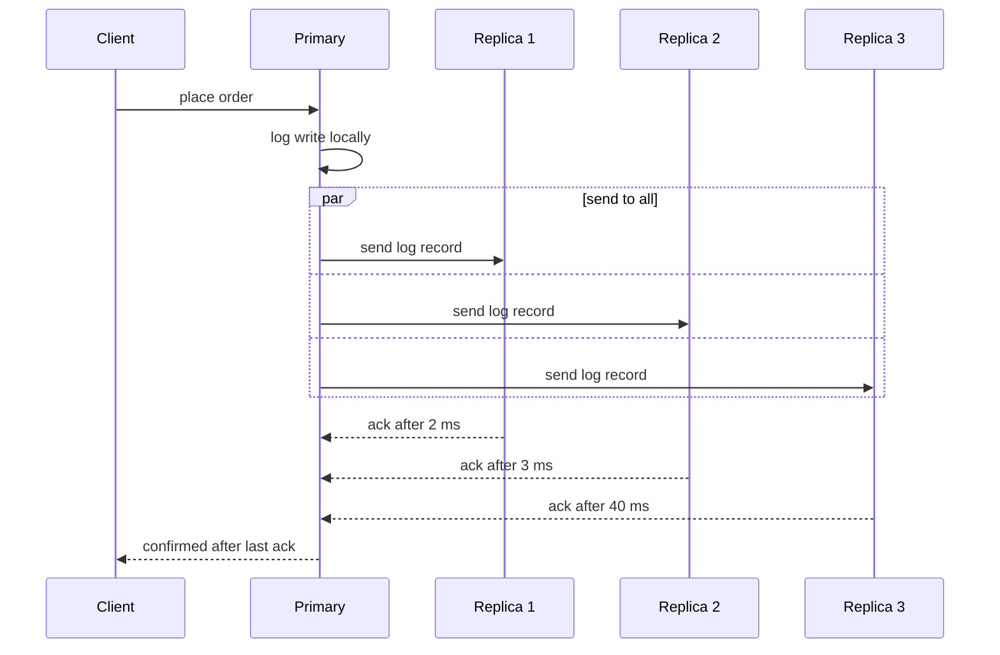

# Socialized-Claude

**A Claude Skill that makes Claude's explanations easier to follow.** The answer
comes first. Ideas arrive in the order they depend on each other. The cause is
spelled out step by step, and a diagram or table appears where the idea has a
shape. It ends with something you can keep.

It is a folder of Markdown instructions. There's no API key, no paid inference,
no server, and no code that runs on your machine. It installs into the Claude
account you already have.

> **Status: experimental, version 2.2.0.** It installs and works on claude.ai.
> It has **not** been shown to improve understanding in a controlled test. See
> [What is and isn't known](#what-is-and-isnt-known).

## What changes

| You ask | Without the skill | With the skill |
|---|---|---|
| "Why does X happen?" | The point arrives in paragraph three | The answer is the first sentence, then the chain of cause and effect |
| "How does X work?" | Terms used before they're defined | Each term gets a short gloss the first time it appears |
| A mechanism with steps or branches | Paragraphs describing the steps | A Mermaid diagram, a table, or bars, with the prose they replace removed |
| "Should we do A or B?" | A balanced essay | A recommendation, the tradeoff it turns on, and what would change it |
| "Why is this failing?" | A list of possible causes | The likely cause, its evidence, one fix, and the check that confirms it |
| "What's the default port?" | A short answer | The same short answer. Quick facts stay quick |

It also pitches the answer at the reader. A student and an engineer who's new to
the topic get different starting points for the same question. It keeps standing
instructions ("under 100 words from now on") for the whole chat. After a
correction, it re-reads what you asked instead of repeating itself.

It leaves other requests alone: translation, editing your text, creative
writing, greetings, and plain code changes get normal answers.

## What an answer looks like

This excerpt is a real claude.ai answer to *"Why does adding more replicas to a
database sometimes make writes slower instead of faster?"* Read the full
answers, rendered: [replicas](evaluation/layout_capture/round5/replicas.md) and
[monolith vs microservices](evaluation/layout_capture/round5/monolith.md).

> **Why more replicas can slow down writes**
>
> Every replica has to receive and apply every write, and a write usually can't
> finish until some or all replicas confirm it. […] **Replicas scale reads, not
> writes.**



| Mode | Waits for | Speed | Safety |
|---|---|---|---|
| Async | no replica | ✅ fastest | ❌ can lose writes |
| Quorum (majority) | majority of nodes | ⚠️ middle | ✅ survives failures |
| Sync to all | every replica | ❌ slowest | ✅ strongest |

> 🎯 **Takeaway:** more replicas → more acks to wait for and more copies to send →
> slower slowest-case write, same write capacity.

These answers came from build 2.0-dev. Version 2.2.0 keeps this layout and makes
the 🧠 analogy and 🧪 check question depend on the request. A decision or a
debugging answer gets neither.

## Install

### claude.ai (web or desktop)

1. Download `socialized.zip` from the
   [latest release](https://github.com/A-Piyas-04/Socialized-Claude/releases/latest),
   or take [`dist/socialized.zip`](dist/socialized.zip) from this repository.
   Upload it as it is; don't unzip and re-zip it.
2. Open **Customize → Skills** (on some versions **Settings → Capabilities →
   Skills**). If an older `socialized` is installed, delete it first.
3. Upload the ZIP and switch **socialized** on. Code execution ("create and edit
   files") must be enabled. On Team and Enterprise plans an admin may need to
   allow it.
4. Start a new chat. Chats that were already open don't pick up the skill.

### Claude Code

Unzip the release into your skills folder:

```bash
# macOS / Linux
unzip socialized.zip -d ~/.claude/skills/
```

```powershell
# Windows
Expand-Archive socialized.zip -DestinationPath $HOME\.claude\skills\
```

Claude Code shows Mermaid diagrams as source text, so the visuals are less useful
in a terminal than on claude.ai.

## Use it

Ask for explanations as you normally would. Claude decides on its own whether to
load the skill, so it won't apply every time. To make sure it does, start your
message with `/socialized`.

To check that it loaded, expand Claude's activity or thinking and look for
`socialized/SKILL.md` being read. Asking Claude "did you use the skill?" is not
reliable evidence.

For one message without it, say "Answer normally, without the socialized skill."
To stop it for good, switch it off in Skills.

More detail: [`docs/INSTALL_AND_USE.md`](docs/INSTALL_AND_USE.md) (short) and
[`docs/INSTALLATION.md`](docs/INSTALLATION.md) (troubleshooting included).

## What is and isn't known

**Shown:**

- The ZIP is a valid skill. It uploads to claude.ai and loads with `/socialized`.
- Real claude.ai answers follow the layout: title, answer first, numbered
  sections, diagrams, glosses, takeaway. Four rounds of captured answers are in
  [`evaluation/layout_capture/`](evaluation/layout_capture/).
- The Markdown it asks for renders: every example and gold answer passes
  [`scripts/lint_markdown.py`](scripts/lint_markdown.py).

**Not shown:**

- That readers understand more. No comprehension study has been run.
- That answers beat ordinary Claude in a controlled comparison.
- How often it loads without `/socialized`.
- How consistent it is. Each captured round is one answer per prompt.

Known rough edges: openers sometimes run to four sentences instead of two, and
long answers can look alike because they share one page shape.
[`docs/LIMITATIONS.md`](docs/LIMITATIONS.md) has the full list.

## Build and check it yourself

```bash
pip install -r requirements-dev.txt
python -m pytest                          # offline test suite
python scripts/validate_skill.py          # validate the skill source
python scripts/package_skill.py           # rebuild dist/socialized.zip (deterministic)
python scripts/validate_skill.py dist/socialized.zip
python scripts/lint_markdown.py answer.md # check that one saved answer renders
```

The build is deterministic. The same source always gives a byte-identical ZIP,
and `dist/socialized.manifest.json` records its SHA-256. These checks show the
package is well-formed. They don't show that Claude follows it.

## Repository layout

```
skill/socialized/        The skill source
  SKILL.md                 Workflow, operations, accuracy and Markdown rules
  references/              Loaded on demand: methodology, examples, palette, gold answers
dist/socialized.zip      The package to upload, with a hash manifest
scripts/                 Build, validation and lint tools (Python, stdlib + PyYAML)
tests/                   Offline tests (pytest)
docs/                    User docs, architecture, limitations
evaluation/              Captured answers, prompts, and the evaluation framework
research/                Evidence audit for the design
```

## The lab

This repository is also the project's working notebook. None of this is needed to
use the skill.

- [`docs/ARCHITECTURE.md`](docs/ARCHITECTURE.md): how the skill is organised and
  why each operation exists.
- [`research/EVIDENCE_AUDIT.md`](research/EVIDENCE_AUDIT.md): what the earlier
  ExplanationLab experiments do and don't support. In short, the operations are
  hypotheses, not proven techniques.
- [`docs/ADAPTIVE_COMMUNICATION_PLAN.md`](docs/ADAPTIVE_COMMUNICATION_PLAN.md),
  [`docs/SKILL_UPGRADE_PLAN_V2.md`](docs/SKILL_UPGRADE_PLAN_V2.md) and
  [`docs/SKILL_UPGRADE_PLAN.md`](docs/SKILL_UPGRADE_PLAN.md): the change record
  by phase.
- [`evaluation/README.md`](evaluation/README.md): the no-API evaluation framework,
  not yet run end to end.
- [`docs/DEVELOPMENT_REPORT.md`](docs/DEVELOPMENT_REPORT.md),
  `SMART_CLAUDE_V1_*.md` and [`AGENTS.md`](AGENTS.md): original briefs and the
  running decision log.
- [`CHANGELOG.md`](CHANGELOG.md): what changed, by version.

## Licence

[MIT](LICENSE). Copyright (c) 2026 Ahnaf Shahriar Pias. The ZIP carries the same
licence as `LICENSE.txt`.
