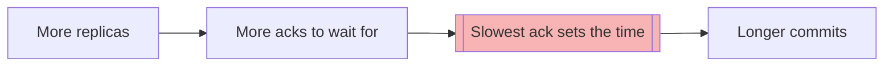
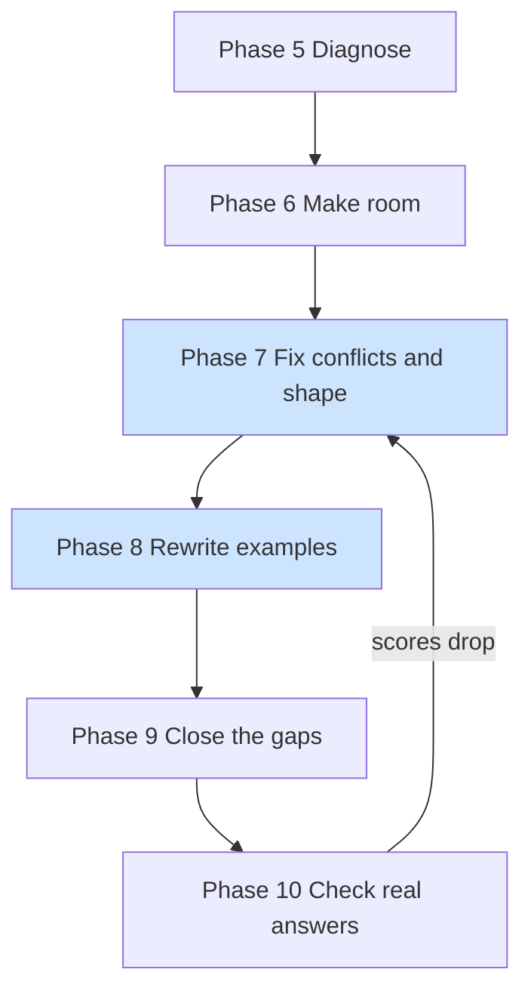

# Skill upgrade plan V2 — from rules on paper to answers on screen

> **Written for:** the project owner and whoever implements the phases.
> **Evidence:** two rounds of real claude.ai answers.
> - **Round 1** (five screenshots, older installed build): database replicas,
>   monolith versus microservices, CPU cache coherence.
> - **Round 2** (nine screenshots, after re-uploading the finished V1 build):
>   database replicas and monolith versus microservices, same prompts.
>
> **Scope:** `skill/socialized/`, its references, and the offline scripts that check it.

---

## 🎯 The short version

**Round 2 is much better, and it tells us what was really wrong.** Most of the
round 1 failures, including "no emoji", came from an old build on claude.ai. Once
the V1 build was installed, the answers gained heading icons, `---` separators,
numbered sections with a map, a status-emoji comparison table, a coloured
decision flowchart, a bar chart, and check questions with listed options.

Six problems survive the reinstall, and they are what V2 is for:

1. 📏 **Every line still looks the same size.** Headings render barely larger than
   body text, and sub-headings look identical to section headings.
2. 🧠 **No analogy, and specialist terms go unexplained.** One line in `SKILL.md`
   causes both: the practitioner register says to spend words "not on definitions or
   analogies", and practitioner is the default reader.
3. 💬 **The conversation is half there.** Reader's questions appear as plain
   sentences, not as visible turns, and the decision answer has none.
4. 🎯 **The close looks like body text.** "Takeaway" and "Check question" are plain
   bold lines, not callouts that stand apart.
5. 🧱 **Openers are still dense.** The first paragraph runs four sentences and
   about 55 words.
6. ✨ **Emoji stop at headings.** The palette of 153 icons is used only for section
   headings and status marks. No callout, label, or key line carries one.

> 💡 **The theme:** V1's layout rules work when installed. What fails now is either a
> **renderer limit** (heading sizes) or a **rule conflict** (register versus voice).
> V2 fixes the conflicts, designs around the limit, and adds a way to check real
> answers so this never again depends on screenshots.

---

## 🔍 1. What the answers actually did

### 📊 Round 1 versus round 2

Legend: ✅ done, ⚠️ partly, ❌ missing. Round 1 sums up three answers on the old
build; round 2 sums up two answers on the V1 build.

| Your ask | Round 1 | Round 2 | Left to fix |
| --- | --- | --- | --- |
| Emoji on headings | ❌ none | ✅ every section | — |
| Emoji beyond headings | ❌ none | ⚠️ status only | Callouts, labels |
| Visible heading sizes | ❌ flat | ❌ flat | Title, levels |
| Top title | ❌ none | ❌ none | `##` or `#` title |
| Spacious, short units | ❌ dense | ⚠️ opener dense | Opener |
| Short list items | ❌ 40–70 words | ✅ short | — |
| Section separators | ❌ none | ✅ mostly | — |
| Numbered sections, map | ❌ none | ✅ both | — |
| Diagram or flowchart | ⚠️ one of three | ✅ both | Overview chain |
| Colour in a visual | ❌ none | ✅ mostly | Sequence colour |
| Table cells short | ❌ long | ✅ short | — |
| Scenario | ⚠️ two of three | ✅ both | — |
| Analogy | ❌ none | ❌ none | Register conflict |
| Reader's questions | ⚠️ two of three | ⚠️ unmarked | Bold turn lines |
| Every term glossed | ❌ often not | ❌ often not | Register conflict |
| Takeaway and check | ⚠️ plain | ⚠️ plain lines | Callouts |
| Markdown unbroken | ✅ | ✅ | — |
| Markdown over SVG | ✅ | ✅ | — |

### 🔗 Round 2: replicas ("walk me through the chain")

What works:

- **Five numbered sections**, each with a fitting icon (🧩 ⏰ 📉 ⚙️ 🔒), a one-line
  map up front, and a `---` between sections.
- **A scenario** ("Say you run a primary database … 1,000 writes per second") and
  **the obvious approach that fails** ("The obvious design is for the leader to write
  locally…").
- **Three visuals that fit their content:** a `sequenceDiagram` of one write, a bar
  block of commit wait (0, 1, 2, 40 ms), and a short table of quorum sizes.
- **Colour by emoji:** a 🟢 🔴 legend line, reused in the diagram's participant names.
- **A check question** with three listed options and a reasoned **Answer:**.

What still fails:

- **Flat sizes.** "1. 🧩 Replicas copy writes…" and the sub-heading "The slowest
  replica sets your latency" render at the same size, both barely above body text.
  The reader cannot see that one sits inside the other.
- **Unglossed terms:** Raft, Paxos, "Dynamo-style stores", the quorum `W`,
  `R + W > N`, "backpressure", "log segments".
- **No analogy** for the core idea (waiting on the slowest of a group), which has an
  everyday counterpart.
- **No overview of the chain.** The question asks for the chain of cause and effect;
  it appears only as a six-link arrow line at the very end, never as a diagram at
  the start.
- **Reader's questions as plain sentences** ("So where does the slowdown come from?"),
  so the turn in the conversation does not show.
- **A four-sentence, 55-word opener**, past the three-sentence ceiling.
- **Takeaway as a plain bold line**, and a six-link chain where a three-link one
  would compress the idea.
- **The sequence diagram has no highlighted step.** The 40 ms ack, the point of the
  diagram, looks like every other arrow.

### ⚖️ Round 2: monolith (decision)

What works:

- **The comparison that was missing in round 1**, now a four-column table with a
  ✅ ⚠️ ❌ legend for fit.
- **A coloured Mermaid decision flowchart** (green for the default, orange for an
  earned split), with an italic caption naming what to notice.
- **A worked load estimate** ("Say each user makes 50 requests a day…") and **the
  obvious microservices pitch**, named and refuted.
- **Numbered actions with bold verbs**, a **Deeper:** block, a three-link takeaway,
  and a listed check question.

What still fails:

- **Flat sizes**, the same as replicas.
- **No reader's question at all.** Round 1's monolith answer had two ("Won't the
  monolith become unmanageable as it grows?"). Round 2 lost the conversation.
- **No analogy**, though the trade has an everyday form (one shared kitchen versus
  six separate kitchens for six cooks).
- **"p95 latency"** used without a gloss.
- **Separators only in places**: between the map and section 1, and before the
  takeaway, but not between every section.

### 🕰️ Round 1 details (older build, kept for comparison)

These were fixed by installing the V1 build, so they need no new rule:

- Emoji absent everywhere; list items of 40–70 words; no `---`; no comparison table
  for the three options; table cells written as sentences.
- An ASCII arrow chart that repeated a numbered list, in the replicas answer.

These round 1 findings still hold:

- Every "Better" example in `references/explanation-examples.md` is a plain
  blockquote of prose with no headings, emoji, or diagram.
- The cache answer, written for a beginner, also had no analogy, and its sequence
  diagram had no highlighted step.

---

## 🧠 2. Why it happens — the root causes

Ranked by how much of the round 2 failures each one explains.

### R1. The practitioner register switches off glosses and analogies

`SKILL.md` lines 336–337, in `op:register`:

> **Practitioner:** use the field's vocabulary freely and spend the words on the
> answer itself, not on definitions or analogies.

Step 1 then makes practitioner the default: "With mixed or absent signals, write for
a practitioner." So nearly every answer runs as a practitioner answer, and two V1
Phase 2 rules lose:

- `op:terms`: "Gloss every term, acronym, and set phrase … in the sentence where it
  first appears or the one before it."
- `op:examples`: "Give an analogy equal standing for a beginner, or for a mechanism
  with no everyday counterpart."

The model resolves the conflict the way the register line says. That is why both
round 2 answers have zero analogies and leave Raft, Paxos and p95 unexplained.

### R2. Heading levels give almost no visible size on claude.ai

- Markdown has no font sizes. The only size control is the heading level, and the
  renderer fixes those sizes.
- On claude.ai, the round 2 section headings and sub-headings render at the same
  apparent size, both close to body text. That points to `###` and `####` (or bold
  lines), which claude.ai styles almost alike.
- The skill's ladder is `##`, `###`, `####` with no title rule. The model numbers
  sections but never writes a top-level title, so the largest size never appears.
- **Confirmed in Phase 5:** the raw markdown shows `##` for sections and `###` for
  sub-sections. The render probe shows `##`, `###` and `####` at the same size on
  claude.ai, and only `#` is visibly larger.

### R3. Turns of the conversation have no visible form

`op:conversational` says to write the reader's question "as its own bolded line or
short heading". In round 2 the questions arrive as plain first sentences of a
paragraph, or not at all. The rule is optional in shape ("line or heading") and in
frequency ("at least once"), and the decision intent is not a teaching answer, so
the monolith answer skipped it.

### R4. The close and the callouts have no visual form

`op:close` says what the takeaway and check question contain, not how they look. So
they come out as a bold word and a sentence, at body size, indistinguishable from
the paragraph above. The palette lists 🎯 and 🧪, but no rule puts them on the close.

### R5. The examples still teach the opposite layout

Round 2 shows the layout rules work on their own. But the voice and close are where
round 2 still falls short, and the worked examples model neither: no reader's
question lines, no analogy callouts, no icon callouts. The model has rules for those,
and no picture of them.

### R6. Rules conflict, and the model picks the familiar side

| Conflict | What the model did |
| --- | --- |
| `op:register` practitioner versus `op:terms` gloss-every-term | Left terms unglossed |
| `op:register` practitioner versus `op:examples` analogy | No analogy |
| Step 2 answer first versus `op:examples` scenario first | Answer, then scenario: fine |
| Heading ladder to `####` versus visible size difference | Flat sizes |
| "None of them is a template" versus a fixed page shape | Shape varies per answer |

### R7. Nothing checks real answers

Every V1 test reads `SKILL.md`; none reads an answer. Round 1 shows the cost: an
outdated build went unnoticed until screenshots were compared by eye.

---

## 📏 3. What markdown can and cannot do

Design to the renderer, not to the wish.

| You asked for | Markdown can do it with |
| --- | --- |
| Big, boldest headers | `#` or `##` title, `##` sections |
| Gap, then sub-header | `---`, then a `###` sub-section |
| Different font styles | **bold**, *italic*, `code`, blockquote |
| Colour | `diff` fence, Mermaid fills, emoji |
| Space in one view | Short units, callouts, separators |
| Flowcharts | Mermaid (renders on claude.ai) |
| Bars and quantities | `█` block characters in a fence |

What it **cannot** do: set a font size, colour a word of prose, or render Mermaid in a
plain terminal (Claude Code shows the source). If the render probe shows `###` and
`####` look the same as bold text on claude.ai, V2 stops using them for structure
and builds hierarchy from title, sections, separators and callouts instead.

---

## 🗺️ 4. The target page shape

One concrete skeleton that the skill shows and every example follows. It is a
**shape**, not wording: a slot whose content does not exist is left out, but no slot
is replaced by a dense paragraph. The heading levels shown here are provisional
until the Phase 5 render probe.

````markdown
## 🔑 Why more replicas can make writes slower

Every replica you add is one more machine the leader must **wait for** before a
write counts.

> 🧭 **In this answer:** 1 · The trap  2 · The chain  3 · The exception



---

## 🕳️ 1 · The trap: more copies should mean more speed

> 🙋 **So why doesn't it work like reads?**

A read needs one replica. A write needs every replica it waits on.

> 🧠 **Think of it like:** a group dinner where the bill is paid only when everyone
> has chipped in. Add guests and the wait grows, because one slow wallet holds up
> the table. *Where it breaks:* a quorum waits for most guests, not all.

---

## 🔗 2 · The chain, step by step

- **🐢 Straggler:** one slow replica delays the whole write.
- **📈 More replicas:** more chances that one of them is slow.

If each replica is slow 1% of the time and a write waits on all of them:

| Replicas | Chance a write hits a slow one |
| --- | --- |
| 3 | 🟢 about 3% |
| 30 | 🔴 about 26% |

---

> 🎯 **Takeaway:** wait on more replicas → wait on the slowest → slower writes

> 🧪 **Check yourself:** a team moves from 3 to 9 replicas and waits on a
> majority. Does write latency rise or fall?
>
> **Answer:** it rises — 5 replicas to wait on instead of 2.
````

What the shape guarantees, slot by slot:

- **Size:** one title, then sections at the largest level that still looks smaller
  than the title. Nothing that renders like body text is used as a heading.
- **Overview first:** a question about a chain or a process opens with its diagram,
  right after the answer.
- **Voice:** at least one reader's question per teaching or decision answer, as a
  🙋 callout line, answered right below it.
- **Analogy:** one 🧠 callout with a named limit, unless the reader is an expert or
  asked for brevity.
- **Terms:** every specialist term carries a short gloss in parentheses on first use,
  at every register except expert.
- **Close:** takeaway and check question as 🎯 and 🧪 callouts, never plain lines.

---

## 🛠️ 5. The phases



The highlighted phases carry most of the change: Phase 7 removes the conflicts that
switch off the voice rules, and Phase 8 shows the result.

---

### 🔍 Phase 5 — Diagnose before changing anything

**Goal:** settle the one open question (which heading levels render how), and make
a stale install impossible to miss again.

| Where | Change |
| --- | --- |
| `SKILL.md` frontmatter | Add `metadata: {version: "2.0-dev"}` so the installed build is identifiable |
| claude.ai render probe | One message with `#`, `##`, `###`, `####`, bold, `---`, blockquote, rendered once (yours) |
| `evaluation/` | Capture the raw markdown of the round 2 prompts through `collect_cc` (no hand-copying) |
| `scripts/` | Run `lint_response.py` and `lint_markdown.py` on each; record what fires |

**Acceptance:**

- ✅ A screenshot of the render probe, and the heading levels that look distinct
  (`evaluation/layout_capture/render_probe-claude-ai.png`).
- ✅ Raw markdown of the round 2 answers saved, with the levels the model used.
- ✅ Version stamp in the built skill (`metadata.version: 2.0-dev`). Seeing it in the
  installed copy on claude.ai is yours to check.

#### Status (2026-11-02)

The `collect_cc` capture was dropped: you supplied the answers by hand. They live in
`evaluation/layout_capture/round2/`:

- `replicas.md` and `monolith.md`, copied from claude.ai;
- nine screenshots in reading order;
- `capture.json`, recording build `e93f3c0`, the explicit `/socialized` invocation and
  the prompts;
- `lint.txt`, the output of both linters.

The prompts are also in `evaluation/layout_prompts.json`. The probe is
`evaluation/render_probe.md`, and its claude.ai screenshot is
`evaluation/layout_capture/render_probe-claude-ai.png`.

**Heading levels:**

- Both answers write sections as `##`, and replicas writes sub-sections as `###`.
  Neither writes a `#` title.
- On claude.ai, `##` and `###` render as bold text barely larger than the body, and
  almost alike. The `##`, `###`, `####` ladder gives no visible hierarchy there.

**Render probe on claude.ai** (`render_probe-claude-ai.png`):

| Device | How it renders |
| --- | --- |
| `#` | ✅ Visibly larger than body, bold |
| `##`, `###`, `####` | ❌ Same size as each other, bold, barely above body |
| Bold line | ❌ Looks like `####` |
| `---` | ⚠️ A faint hairline |
| Blockquote | ⚠️ Left bar, dimmer grey text |

Two consequences for Phase 7:

- **Size:** a `#` title is the only level that adds visible size. `###` and `####`
  give no size over `##`, so depth below `##` must come from separators, numbering
  and callouts, as section 3 anticipated. That answers decision 2 with `#`, for you
  to confirm.
- **Callouts recede:** blockquote text renders dimmer than body text. A 🎯 or 🧪
  callout stands apart through its bar and icon, but it reads quieter, not louder.
  The callout's key words need bold, and the one sentence that must not be missed
  stays in body text.

**Underline probe on claude.ai** (`underline_probe-claude-ai.png`), for the `#` title:

| Technique | How it renders |
| --- | --- |
| `---` under the title | ⚠️ Full-width hairline after a gap; reads as a divider |
| `<u>…</u>` | ❌ Tags shown as literal text |
| Combining U+0332 | ⚠️ A true underline, broken at spaces and punctuation |
| `---` under a `##` | ⚠️ Same as under the title |

**Chosen (2026-11-02):** a `---` directly under the `#` title, separated from it by a
blank line. It renders everywhere and copies cleanly.

**What else the markdown shows:**

- **Opener:** replicas runs four sentences and about 55 words; monolith runs three.
- **Separators:** monolith has `---` only after the map and before the takeaway.
- **Close:** replicas uses a `## Takeaway` heading; monolith uses a
  `**Takeaway:**` line. Neither is a callout.
- **Check options:** replicas writes bare `A)` lines, which render as one block.
  Monolith writes a `-` list.
- **Reader's questions:** replicas has two, as bold lead-ins inside a paragraph.
  Monolith has none.
- **Callouts:** only **For implementers:** and **Deeper:**. There is no 🙋, 🧠, 🎯
  or 🧪.
- **Unglossed:** Raft, Paxos, Dynamo-style, `W`, `R + W > N`, backpressure, log
  segments, p95.

**Linters:**

- `lint_markdown.py`: no breaks in either answer.
- `lint_response.py`, replicas: `heading_thin`, four `dense_paragraph`,
  `empty_transition`, `emphasis_overuse`.
- `lint_response.py`, monolith: `dense_paragraph`, `bullets_unconnected`,
  `empty_transition`, `emphasis_overuse`.

**A metric gap for Phase 10:** `icon_count` reads 0 for both answers, though every
section heading carries an icon. The metric expects the icon first, and these headings
put a number first (`## 1. 🧩 …`). Phase 10's conformance score must look past the
number.

---

### 🧱 Phase 6 — Make room (the budget is spent)

**Goal:** free about 60 lines in `SKILL.md`, so the shape and the conflict fixes can
sit near the top.

```
SKILL.md now   █████████████████████████████████████████████████░  494 / 500
after Phase 6  ███████████████████████████████████████████░░░░░░░  ~435 / 500
```

| Move | Lines freed | Cost |
| --- | --- | --- |
| Strategy section → reference, 3-line pointer | ~20 | Strategies read on demand |
| Step 3: 17 questions → 9, keyed to the shape | ~15 | None; same checks, grouped |
| `op:repair`, `op:work-report` detail → reference | ~15 | Rare cases read on demand |
| Merge duplicate visual and presentation bullets | ~10 | None |

**Acceptance:** body at most 440 lines; every moved rule still reachable by a
pointer; `test_presentation_upgrade.py` registry updated and green.

#### Status (2026-11-02): ✅ done

Counts are the validator's (`body.count("\n") + 1`).

```
before Phase 6  █████████████████████████████████████████████████░  494 / 500
after Phase 6   ████████████████████████████████████████████░░░░░░  440 / 500   rendered 389
```

| Move | Where it went | Lines |
| --- | --- | --- |
| Strategy, repair, work-report detail, Step 3 | Methodology §15–17; Step 3 regrouped | −34 |
| Duplicate bullets merged | `op:presentation`, `op:visual` | −4 |
| Pointer paragraphs and tightenings | Listed below | −16 |

**Methodology file:** all moved text is in `references/explanation-methodology.md`. The
repair and work-report sections sit inside their op markers, so `rep` and `wrep` keep
them and `core` does not. Each operation keeps its heading and a pointer line.

**Step 3:** it stops at 12, not 9. Every operation check stays inside its own markers,
so each single-op ablation build keeps its check; a block marked with two operations
would drop out of both. Merged pairs: answer-first with delete-a-paragraph, markdown
with hedges, the two presentation checks, and the two visual checks. The persistence
check was cut because `op:persistence` already says to check every standing
instruction before sending.

**Smaller tightenings (no rule dropped):**

- The repair and work-report pointers became one paragraph each, under their heading.
- Step 2's closing "add length only when…" line, which repeats the "conceptual why or
  how" rule.
- The Scope pointers became three marked bullets.
- The Reference files entries were shortened.
- Four bullets were reflowed.
- The expert clause in `op:sequencing` now leans on Step 2's "narrow advanced
  question".

**Tests:**

- `MOVED` in `test_presentation_upgrade.py`: each moved rule is checked in the
  reference for the right build, and so is its pointer in `SKILL.md`. Deleting either
  fails.
- A raw-body guard of 440 or fewer lines in `test_skill_structure.py`.

**Phase 7 line references, now:** `op:register` practitioner is `SKILL.md` line 305,
and the Step 1 default is line 59. "None of them is a template" now lives in
methodology §15.

---

### 🗺️ Phase 7 — Fix the conflicts, then fix the shape

**Goal:** no rule switches another off, and the page shape is a default rather than a
rule to weigh.

| Where | Change |
| --- | --- |
| `op:register` practitioner (line 305 after Phase 6) | Keep the field's vocabulary, **and** gloss each specialist term in a parenthesis of six words or fewer. Keep one analogy in any teaching answer. Only the expert register drops both |
| Step 1 default reader | Keep practitioner as the default, now that it glosses |
| `op:conversational` | At least one reader's question in every teaching **and decision** answer, written as a `> 🙋 **…?**` line with the answer right below it |
| `op:close` | Takeaway and check question become `> 🎯 **Takeaway:**` and `> 🧪 **Check yourself:**` callouts, options as a list |
| `op:presentation` heading ladder | One `#` title with a `---` directly under it (blank line between), then `##` sections. Section headings are not underlined. `###` and `####` give no size on claude.ai (Phase 5 probe), so depth below `##` comes from separators, numbering and callouts |
| `op:presentation` opener | The opening paragraph is two sentences at most; any qualifier moves into its own short unit |
| New always-on "Page shape" section, after Scope | The skeleton in short form (~20 lines), stated as defaults for any answer of two or more sections |
| Methodology §15 (moved in Phase 6) | "None of them is a template" becomes "the page shape is fixed; the wording never is" |

**Acceptance:**

- ✅ Every conflict in R6 has one written resolution.
- ✅ Step 3 asks: "Is there a title, does every section heading carry its icon, and is
  there a 🙋 question, a 🧠 analogy, and a 🎯 takeaway callout?"

#### Status (2026-11-02): ✅ done

```
after Phase 6   ████████████████████████████████████████████░░░░░░  440 / 500
after Phase 7   ████████████████████████████████████████████████░░  480 / 500   rendered 415
```

How each R6 conflict was resolved:

| Conflict | Resolution in the rules |
| --- | --- |
| Practitioner vs gloss every term | Practitioner glosses in a short parenthesis; only expert drops it |
| Practitioner vs analogy | One 🧠 callout in non-expert teaching and decision answers |
| Answer first vs scenario first | Answer sentences first; the scenario opens section 1 |
| Heading ladder vs visible size | One `#` title over `##` sections; no depth from `###` or `####` |
| "Not a template" vs fixed shape | "The shape is fixed; the wording never is" |

Each resolution is also stated in `references/treatment-selection.md` §2.

**Page shape:**

- A new always-on section follows Scope.
- Each slot sits inside its operation's markers, so a single-op build carries only
  its own slots. The `core` build gets the heading, the fixed-shape sentence and the
  Answer slot.
- The slots are: title, answer, overview diagram, map and sections, 🙋 question, 🧠
  analogy, glosses, and the 🎯 and 🧪 close.

**Other rule changes:**

- The reader's question applies to decision answers too, as a `> 🙋 **…?**` line.
- The close is two callouts, with the options as a list and **Answer:** inside.
- The opener is two sentences at most.
- The must-not-miss bold sentence stays in body text, because callouts render
  dimmer.
- The markdown section gains the blank line before a `---` under text.
- `conversation-grammar.md` shows its worked questions in the 🙋 form.

**Step 3:** the acceptance question is split across the marked checks:

- title in Layout;
- section icon in Visuals;
- 🙋 in Voice;
- 🧠 in Example;
- 🎯 and 🧪 in Close.

The full build asks all of it.

**Tests:**

- 25 new registry rules, each with a removal test.
- Three superseded anchors updated: the emphasis ladder, the bolded question line,
  and "equal standing".
- A retired-phrase test across every skill file.
- A Page shape slot test.
- Page shape in every variant.
- Body guard 480.

**Round 3 (claude.ai, build `e14f024`):** the markdown, pasted by you, is in
`evaluation/layout_capture/round3/`.

| Phase 7 target | Replicas | Monolith |
| --- | --- | --- |
| `#` title, then `---` | ✅ | ✅ but 17 words |
| `##` only, icon on each | ✅ | ✅ |
| `---` between sections | ✅ | ✅ |
| Opener of two sentences | ⚠️ two, 58 words | ❌ three |
| Overview diagram first | ⚠️ after the map | — |
| 🙋 question callout | ✅ two | ✅ one |
| 🧠 analogy, limit named | ✅ | ✅ |
| Glosses on first use | ✅ nearly all | ✅ |
| 🎯 and 🧪 callouts | ✅ | ✅ |
| Markdown renders | ✅ | ❌ table broken |

What still fails:

- **Broken table (monolith):** the separator row is `|---\|---\|---\|---|`. The
  model escaped the pipes of the separator row, so claude.ai prints the table as
  text. `lint_markdown.py` misses it, because it only checks a table whose second
  line is a valid separator.
- **Answers inside the 🙋 callout:** both answers put the reply inside the blockquote,
  so the key explanation renders dim, and the callout runs 50 to 75 words.
- **Long title and long opener:** the monolith title is a 17-word sentence. Its
  opener has three sentences, the first a bold lead-in.
- **Order and meta:** the replicas map comes before the overview diagram, and "I'll
  use one running example." announces instead of teaching.
- **Six-link takeaway (replicas):** Phase 9 targets three or four links.
- **Monolith flowchart:** no `classDef` colour; one label of five words.
- **Unglossed:** "GC pause" and "vacuum".

**Follow-up fixes (2026-11-02), body still 480:**

| Failure | Fix |
| --- | --- |
| Escaped separator row | Markdown rule: keep the `\|---\|` row plain |
| Linter blind to it | New `lint_markdown` code `broken_table_separator` |
| Answer inside 🙋 callout | Question alone, a blank line, the answer in body text |
| 17-word title | `#` title of about eight words |
| Three-sentence opener | A bold lead-in counts as one of the two sentences |

The six-link takeaway stays with Phase 9. The overview order, the announcing
sentence, the uncoloured flowchart and the two glosses are not addressed yet.

---

### 📝 Phase 8 — Rewrite the examples to match the rules

**Goal:** the model sees the voice and the close, not only reads about them.

| Where | Change |
| --- | --- |
| `references/explanation-examples.md` | Rewrite every "Better" answer in the target shape: title, icons, `---`, 🙋 question, 🧠 analogy, 🎯 and 🧪 callouts, a visual where the content has a shape |
| **New** `references/layout-exemplars.md` | Three full gold answers: replicas (practitioner mechanism), monolith (decision), cache coherence (beginner). Complete answers, not fragments |
| `SKILL.md` Reference files | One pointer line: read it before a long or teaching answer |
| Tests | Every example passes `lint_markdown.py` and fires no `lint_response.py` flag |

**Acceptance:** no worked example is a heading-less prose block, except the ones that
show "a short answer stays short".

---

### 🧩 Phase 9 — Close the real gaps

| Gap | Rule to add |
| --- | --- |
| Chain or process question | Open with an overview `flowchart LR` right after the answer |
| Linear flow of 5+ steps | Mermaid `flowchart LR`, key node classed; never box-art text |
| Highlight in a sequence diagram | `rect rgb(...)` around the step to notice |
| Callout kinds | 💡 key idea · ⚠️ pitfall · 🧠 analogy · 🙋 question · 🎯 takeaway · 🧪 check |
| Labelled bullets | A palette icon may lead the bold label when the list has three or more items |
| Quantities in a sentence | Two or more numbers compared → bars or a two-column table |
| Takeaway length | Three or four links in a chain, not six |

`scripts/structural_metrics.py`: `DENSE_ITEM_WORDS` 40 → 30, matching the skill's
"about 25 words" with slack. New flag `linear_ascii_flow`: a code block of arrows and
box characters outside Mermaid.

**Acceptance:** each gap has its rule, a test fixture, and an example in
`layout-exemplars.md`.

---

### 🧪 Phase 10 — Check real answers, automatically

**Goal:** never again depend on screenshots to know whether the skill works.

| Where | Change |
| --- | --- |
| **New** `scripts/layout_conformance.py` | Scores a response: title, heading levels, icons per heading, callouts present (🙋 🧠 🎯 🧪), longest opener, longest list item, visuals, colour, glossed terms, `lint_markdown` clean |
| **New** `evaluation/layout_prompts.json` | The three screenshot prompts plus seven more across registers and intents |
| `collect_cc` run | Before-and-after answers for the ten prompts, automatically, on the subscription |
| Report | One table per run: prompt × score, before versus after |

The scores are **measurements**, never gates on the skill text, per the standing
framing that heuristics never gate.

**Acceptance:**

- ⬜ Ten baseline and ten V2 answers collected without hand-copying.
- ⬜ On the V2 answers: every long answer has a title, icons on every section heading,
  a 🙋 question and a 🎯 takeaway callout; a 🧠 analogy in every non-expert teaching
  answer; no opener past two sentences; no `lint_markdown` break.

---

## ⚠️ 6. Risks

- **Over-glossing an expert.** Parenthetical glosses slow a reader who knows the
  field. Guard: the expert register keeps dropping them.
- **Forced analogies.** An analogy that does not keep the causal structure misleads.
  Guard: V1's rule stays — keep the causal structure and name where it breaks, or
  leave the analogy out.
- **Template monotony.** A fixed shape can make every answer look the same. Guard:
  the shape applies from two sections up; a short answer stays short.
- **Emoji soup.** Callout icons plus heading icons plus label icons can crowd the
  page. Guard: one icon per heading, one per callout, labels only in lists of three
  or more, and V1's "more icons than headings" check counts callouts as headings.
- **Mermaid outside claude.ai.** Claude Code shows Mermaid as source. Guard: the
  conformance run records the surface.
- **Subscription cost.** Phase 10 runs 20 answers per comparison. Guard: once per
  phase, not per edit.
- **Proving comprehension.** None of this shows readers understand more. Only the
  evaluation harness could show learning.

---

## ❓ 7. Decisions for you

| # | Decision | Why it is yours |
| --- | --- | --- |
| 1 | Gloss terms and add an analogy for practitioners too? | Fixes R1; makes practitioner answers longer |
| 2 | `#` or `##` for the title? | ✅ Decided 2026-11-02: `#`, title only, with a `---` under it |
| 3 | Move strategy, repair and work-report detail to references? | Frees the room; rare cases read on demand |
| 4 | Icons on bullet labels as well as headings? | More colour, more drift risk |
| 5 | Spend subscription quota on Phase 10 runs? | 20 answers per comparison |
| 6 | Three gold exemplars, or more? | More examples, more lines to maintain |

**The takeaway:** round 2 proved V1's layout rules work once installed. V2 removes
the one register line that switches off glosses and analogies, builds size
hierarchy the renderer can actually show, gives the conversation and the close a
visible form, and measures real answers instead of screenshots.
