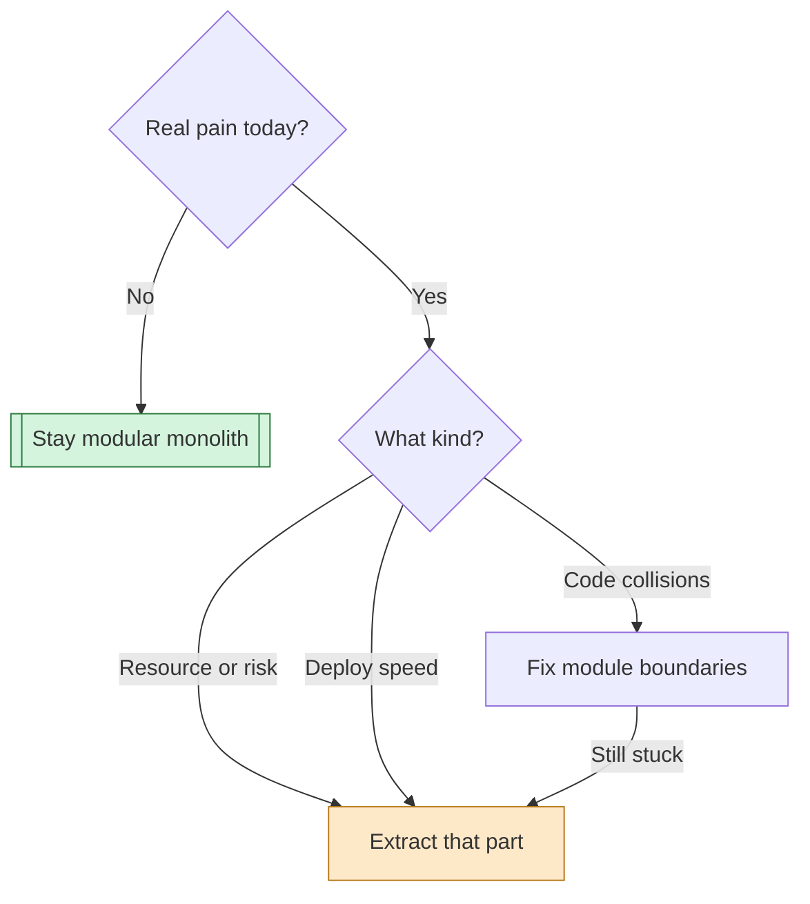

Keep the monolith, but make it modular. Split out a service only when you can name a specific problem it fixes. Full microservices is the wrong fit for six people.

Here's the map: 1) the load, 2) what each option costs, 3) when two services is right, 4) what to do now.

---

## 1. 📊 Your load isn't the problem

40k daily users is small. Say each user makes 50 requests a day (illustrative). That's 2M requests a day, about 23 per second on average and maybe 100 per second at peak. A well-built monolith on a few instances handles that comfortably.

So scale isn't what you're solving. Whatever pushes you toward a split is probably something else, like deploy friction or people tripping over each other.

## 2. ⚖️ What each option costs

Legend: ✅ good fit, ⚠️ only with a reason, ❌ poor fit.

| Option | You gain | You pay | Fit for 6 people |
|---|---|---|---|
| Modular monolith | Simplicity, fast changes | Needs discipline | ✅ |
| Monolith plus two services | Isolation for two parts | Two pipelines, network calls | ⚠️ |
| Full microservices | Independent team ownership | Heavy ops and debugging | ❌ |

The obvious microservices pitch is "one service per domain, each owned by a team." It fails because you don't have teams. You have six people who would all share the on-call rotation, the deploy pipelines, and the debugging across services.

Every split also turns a function call into a network call. That brings timeouts, retries, partial failures, and data that can no longer be updated in one database transaction. **That cost is permanent, and you pay it on every feature that crosses the boundary.**

## 3. 🔀 When splitting out a service is right

**Good reasons**, each tied to a real symptom:
- **Different resource profile.** For example, PDF generation or image processing starves your web workers of CPU.
- **Different risk profile.** Payments, say, needs tighter access control or audit than the rest.
- **Different deploy cadence.** One part needs to ship hourly while the rest ships weekly.

**Bad reasons:** "cleaner architecture," "we might hit 1M users," or "that's what big companies do."

Here is how to decide:

*Green is the default. Orange is a split you've earned. Notice that most paths end at the default or at fixing boundaries first.*

## 4. 🛠️ What to do now

1. **Draw module boundaries inside the monolith.** Each module owns its tables and exposes a small interface. Other modules call the interface, not the tables.
2. **Move slow work to a background queue.** This gives you most of the isolation of a separate service without a second deployable.
3. **Write down your extraction triggers.** For example: "if report generation pushes web p95 latency over X, we extract it." Then you aren't arguing from opinion later.
4. **Revisit in six months** against those triggers.

> **Deeper:** Clean module boundaries are also what make a later extraction cheap. If a module can't be pulled out of the monolith without a rewrite, that's the thing to fix first.

I'm working without knowing your actual pain. If deploys are blocking each other or one component is eating CPU, the answer shifts toward the two-service option.

---

**Takeaway:** pain first → boundaries second → extraction last.

**Check question:** Which is a good reason to extract a service?
- a) The architecture would look cleaner
- b) Report generation starves web workers of CPU
- c) You might reach 1M users someday

**Answer:** b. It's a concrete, measurable symptom that isolation fixes. The other two are speculation.

If you tell me what's actually hurting right now, I can say which of the two services (if any) is worth splitting out.
