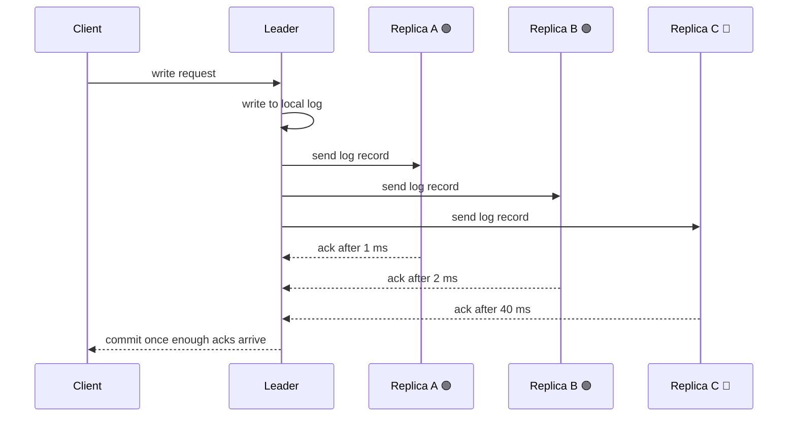

Adding replicas rarely speeds up writes, because every replica must apply every write. Once the database waits for replicas to confirm each commit, more replicas also mean more waiting. This applies to leader-based setups with synchronous or quorum replication. With purely asynchronous replication, the wait part mostly disappears.

Here's the chain in five steps: (1) what replicas copy, (2) what a commit waits for, (3) how waiting grows, (4) the leader's extra work, (5) lock contention.

---

## 1. 🧩 Replicas copy writes, they don't share them

Say you run a primary database (the "leader") that takes 1,000 writes per second, plus read-only copies (the "replicas" or "followers"). You add replicas to handle load.

Every replica must apply all 1,000 writes per second. None of them takes a share of the writes. Replicas add read capacity and fault tolerance, but they don't add write capacity.

**So where does the slowdown come from?** From what the leader does before it tells your client "committed."

---

## 2. ⏱️ A commit waits for acknowledgements

The obvious design is for the leader to write locally, answer the client, and copy the change afterward (**asynchronous replication**). That's fast, but if the leader dies before copying, a committed write is lost. To prevent that, many systems make the leader wait until some replicas confirm they've durably stored the change (**synchronous** or **quorum** replication).

Legend: 🟢 fast replica, 🔴 slow replica.

The sequence below shows one write. Notice that the client's wait ends at a confirmation, not at the leader's own work.



How many acks count as "enough" is the setting that decides everything else.

---

## 3. 📉 More replicas make the required wait worse

There are two ways the wait grows.

### The slowest replica sets your latency

If the leader waits for all replicas, the commit takes as long as the slowest one. Each added replica is another chance that one of them is slow right now, because of a disk hiccup, a network blip, or a distant region.

Illustrative commit wait with replicas at 1 ms, 2 ms and 40 ms:

```
wait for none (async)     █ 0 ms
wait for fastest 1 ack    █ 1 ms
wait for fastest 2 acks   ██ 2 ms
wait for all 3 acks       ████████████████████████████████████████ 40 ms
```

### Quorums get bigger as the cluster grows

Consensus systems such as Raft and Paxos wait for a majority. A bigger cluster needs a bigger majority.

| Cluster size | Total acks needed | Follower acks needed |
|---|---|---|
| 3 nodes | 2 | 1 |
| 5 nodes | 3 | 2 |
| 7 nodes | 4 | 3 |

Waiting for the 3rd-fastest follower is slower than waiting for the 1st. Going from 3 nodes to 7 moves your wait from the fastest follower to the third-fastest.

**What if the system only waits for a fixed number of acks?** Then extra replicas add little latency, but they add leader work (next section). Dynamo-style stores (Cassandra, for example) work this way, but they raise the write quorum `W` when you add nodes if you want reads to stay consistent (`R + W > N`).

---

## 4. ⚙️ The leader does more work per write

Even if the wait doesn't change, the leader still has to send each log record to every replica.

- **Network:** 1,000 writes per second at 5 KB each is about 5 MB/s per replica. With 10 replicas, the leader sends about 50 MB/s.
- **CPU and processes:** the leader serializes, tracks, and handles acks for each follower connection.
- **Lag handling:** a replica that falls behind forces the leader to keep old log segments around or apply backpressure.

A busy leader responds more slowly to everything, writes included.

---

## 5. 🔒 Slower commits hold locks longer

A transaction typically holds its row locks until the commit finishes. If each commit now waits 40 ms for a replica instead of 1 ms, every lock lasts 40 ms longer.

Other transactions that need those rows queue behind them. On hot rows (a counter, an inventory count) this stacks up: throughput drops and latency rises even though the CPU and disk are idle.

> **For implementers:** in PostgreSQL this is controlled by `synchronous_commit` (when the commit is reported) and `synchronous_standby_names` (which standbys must confirm). The `ANY n (...)` form waits for any `n` standbys, so a single slow standby doesn't stall commits. The `FIRST n (...)` form waits for the first `n` listed, in priority order.

---

## Takeaway

More replicas → more copies to ship → a larger or slower acknowledgement wait → longer commits → longer lock holds → lower write throughput.

**Check question:** A cluster waits for *all* replicas before committing. You add a replica in a distant region. What happens to write latency?

A) It stays the same, because the other replicas still ack quickly
B) It rises to at least the round trip to the distant region
C) It drops, because the load is spread across more nodes

**Answer:** B. The commit waits for the slowest replica, and writes aren't spread across replicas.

I can turn this into an interactive version where you drag the replica count and latencies and watch commit time change, if that would help.
