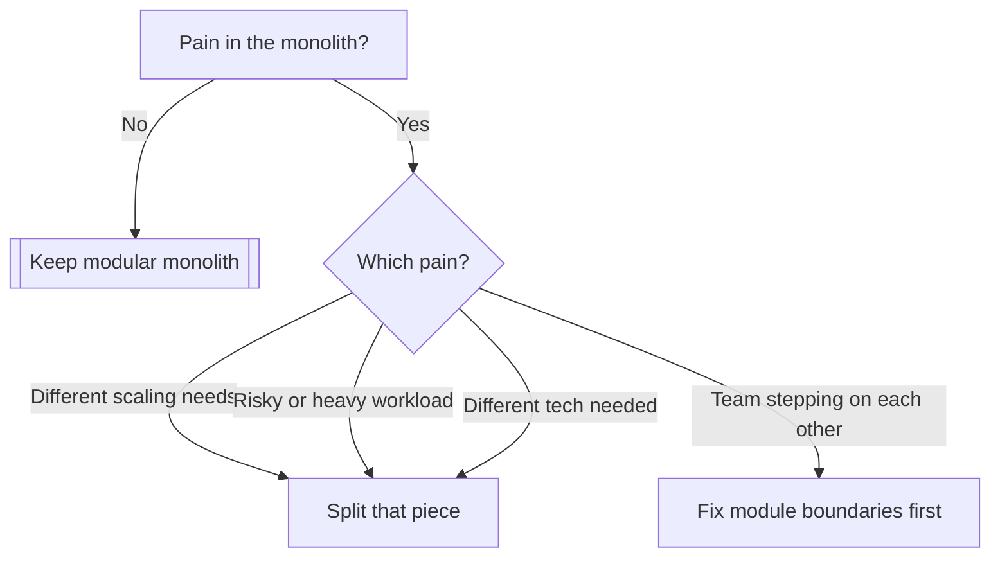

# Keep the monolith, make it modular, and split out a service only when something forces you to

---

**Keep the monolith.** With six engineers, one product and about 40k daily users, microservices (many small, separately deployed programs) would cost you more than they'd return. Split out one or two services later, only for a specific reason you can name.

The sections below cover why the cost is high (1), what to do instead (2), and when to split (3).

---

## 1. 💰 Why full microservices costs more than it returns

Say your checkout code is slow and the team wants it separate. In a monolith, checkout calls the user code as a plain function call. After a split, that call becomes a network request, and network requests fail, time out and arrive out of order.

You then have to build the machinery that makes this safe:

- **Service discovery** (how one service finds another's address)
- **Distributed tracing** (following one request across several services)
- **Retries and timeouts**
- **Contract versioning** (agreeing on message formats between services)
- **One deploy pipeline per service**

> 🙋 **But 40k daily users is a lot, isn't it?**
> It isn't much load. If peak traffic is, say, 10x the average, you're looking at tens of requests per second. One well-tuned monolith, a database and a cache handle that comfortably. Scale isn't your problem, so splitting won't fix anything.

The real constraint is people. Microservices mostly solve the problem of many teams stepping on each other. Six people on one product don't have that problem.

> 🧠 **Think of it like:** a six-person restaurant. A monolith is one kitchen. Full microservices gives every dish its own kitchen with its own door, and the staff now spend their day carrying plates between kitchens. The analogy breaks down at real scale: a restaurant chain does need separate kitchens, and a company with fifty engineers does need separate services.

---

## 2. ⚖️ How the three options compare

Legend: 🟢 good fit, 🟡 acceptable, 🔴 poor fit, for your team of six.

| Option | Ops burden | Team fit | Reversibility |
|---\|---\|---\|---|
| Modular monolith | 🟢 Low | 🟢 Strong | 🟢 Easy |
| Monolith plus two services | 🟡 Moderate | 🟡 Depends on reason | 🟡 Moderate |
| Full microservices | 🔴 Heavy | 🔴 Weak | 🔴 Hard |

A **modular monolith** is one deployable program split inside into clear modules, such as billing, accounts and search. Each module exposes a small interface and keeps its tables to itself. You get most of the clarity of services without the network.

The tradeoff is discipline. Nothing but your team's habits stops one module from reaching into another's tables, so enforce the boundaries with lint rules or architecture tests.

---

## 3. 🔀 When to split out a service

Split out a piece only when one of these is true:

*This shows the decision path. Notice that "slow" or "messy" alone never leads to a split.*

Good candidates are a heavy background job (video processing, report generation), or a piece that needs ten times the CPU of everything else. Those are your "two services" if they ever arrive. If no such piece exists today, don't invent one.

> **For implementers:** Extract a module only after its interface has been stable for a while, and give it its own database. Services that share a database are a monolith with extra network hops.

---

> 🎯 **Takeaway:** Six people and 40k users → one modular monolith → split a piece only for a named scaling, risk or technology reason.

> 🧪 **Check yourself:** Your search feature needs ten times the memory of everything else and crashes the app under load. What's the sensible move?
> - A) Go full microservices
> - B) Extract search as one service
> - C) Do nothing
>
> **Answer:** B. It's a concrete, isolated resource problem, which is exactly the case where a split pays for itself.

I can also sketch a module layout for your monolith or a checklist for judging a proposed split.
