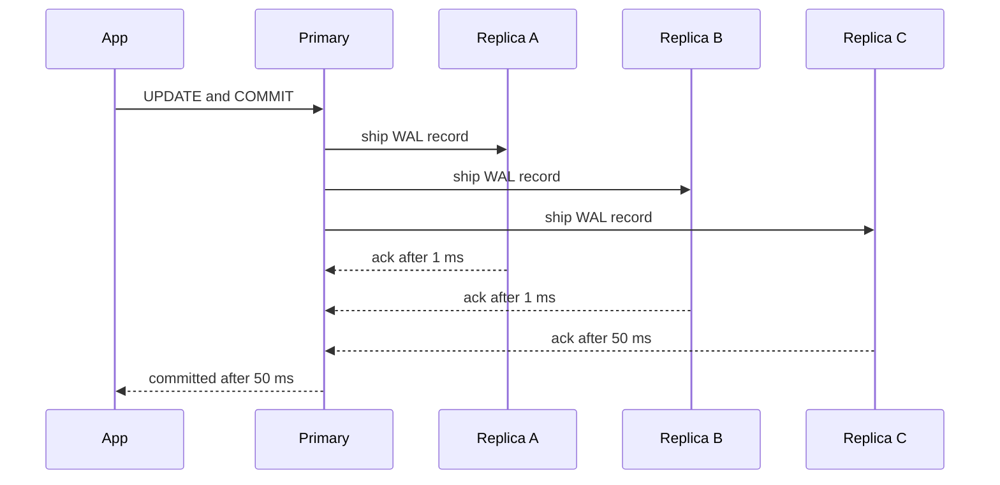

# Why more replicas can make writes slower

---

Every replica (a full copy of the database) has to receive and apply every write, so adding one never adds write capacity. If the primary (the node that accepts writes) waits for replicas before confirming a commit, each extra replica gives the commit one more chance to be delayed.

The chain runs through five steps: 1) the obvious idea fails, 2) commits wait on the slowest replica, 3) waiting turns into lost throughput, 4) other costs pile on, 5) how to avoid it all.

Colour code for the diagram: blue is what you changed, red is the harm that follows.


I'll use one running example. Say you run Postgres with synchronous replication, and your app updates a hot row, like a stock counter for a popular product. The numbers below are illustrative.

---

## 1. 🧩 The obvious idea, and why it fails

The obvious idea is that more machines mean more capacity. That's true for reads, because any replica can answer a query.

It fails for writes because a replica is a copy, not a slice. Each one replays the same stream of changes, so the write work gets repeated N times instead of divided N ways. To scale writes, you split the data across nodes (sharding, or partitioning). Replication doesn't do that.

---

## 2. ⏱️ A commit waits on the slowest replica

Synchronous replication means the primary doesn't tell your app "committed" until replicas confirm they've stored the change. The primary sends the change as a WAL record (write-ahead log, the database's ordered change journal).

This diagram shows one commit. Notice that the shipments go out at the same time, but the commit finishes only when the last required ack (acknowledgment) arrives.



> 🙋 **If most acks take 1 ms, why does one slow replica matter?**
> The commit time is the maximum of the ack times, not the average. Say each replica has a 1% chance of being slow on any given write (a GC pause, a disk flush, a network blip). The chance that at least one of N replicas is slow is 1 − 0.99^N, and it grows with every replica you add.

This is tail latency (the rare slow cases) leaking into the typical case:

| Replicas | Chance a commit hits a slow ack | Average commit time |
|---|---|---|
| 1 | 1% | 1.5 ms |
| 3 | 3% | 2.5 ms |
| 10 | 9.6% | 5.7 ms |

Here "slow" means 50 ms and "fast" means 1 ms. With 10 replicas, nearly one commit in ten pays the slow price.

> 🧠 **Think of it like:** a group chat where nobody can leave until everyone replies "got it". The more people in the chat, the likelier somebody is away from their phone. The analogy stops holding because replicas also do real work, as the next two sections show.

---

## 3. 🔒 Waiting while holding locks destroys throughput

Here's the step people usually miss. While your transaction waits for acks, it still holds its row lock (a claim that blocks other writers to that row). Every other write to the hot row has to wait behind it.

So a hot row can only commit about `1 / (time the lock is held)` writes per second. When commit time goes up, that ceiling comes down, and writers queue up behind it.

Bars show the hot-row ceiling, scaled to the largest:

```
1 replica    ████████████████████████████  ~670 writes/s
3 replicas   █████████████████             ~410 writes/s
10 replicas  ███████                       ~175 writes/s
```

> 🙋 **Isn't this only a problem for hot rows?**
> It's worst there, but any contention is hit. Longer lock holds also keep connections busy longer, so your connection pool and worker threads fill up sooner, even on rows that aren't hot.

---

## 4. ⚙️ Other costs that stack on top

Even when you don't wait for all replicas, more replicas still cost the primary something:

- **Fan-out cost:** the primary sends each WAL record to every replica. Ten replicas means ten copies of the write stream leaving one network card, plus ten sender processes. Bandwidth and CPU on the primary grow roughly linearly.
- **Bigger quorums:** in consensus systems like Raft (a protocol where a majority must agree), a write needs acks from a majority. Going from 3 nodes to 5 raises that from 2 acks to 3, with more messages per write and a higher chance one of the required nodes is slow.
- **Replica apply lag:** every replica must replay every write. One replica with a slow disk falls behind, and if commits wait on it, it stalls them.

> **For implementers:** in Postgres, `synchronous_standby_names = 'ANY 2 (a, b, c, d, e)'` makes commits wait for any 2 of 5 replicas instead of a fixed one. Also watch `hot_standby_feedback`, which can delay vacuum on the primary when long queries run on a replica.

---

## 5. 🛠️ How to avoid it

- **Wait for fewer acks:** use a quorum like "any 2 of N" so the slowest replicas don't set your latency.
- **Make most replicas asynchronous:** they still serve reads, but commits don't wait on them. The tradeoff is that an async replica can lose recent writes if the primary fails.
- **Shorten transactions and avoid hot rows:** this shrinks the time any lock is held.
- **Shard when writes are the bottleneck:** this is the only approach that actually adds write capacity.

---

> 🎯 **Takeaway:** more replicas → more acks to wait for → commit waits on the slowest → locks held longer → writers queue → lower throughput.

> 🧪 **Check yourself:** You have 5 synchronous replicas and write latency keeps creeping up. Which change most likely helps?
> - a) Add a 6th replica
> - b) Require acks from any 2 of the 5 instead of all 5
> - c) Move all reads onto the primary
>
> **Answer:** b. It stops the slowest replicas from setting commit time. Option a makes the "max of N" problem worse, and option c adds load to the primary without shortening any commit.

Want an interactive version where you slide the replica count and watch commit time and the hot-row ceiling change?
