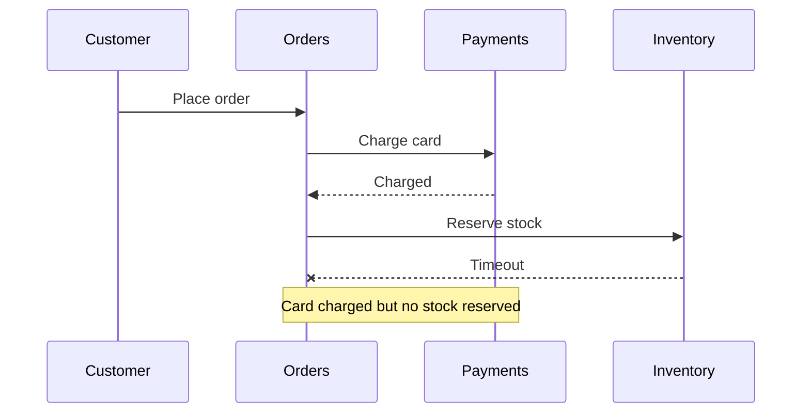
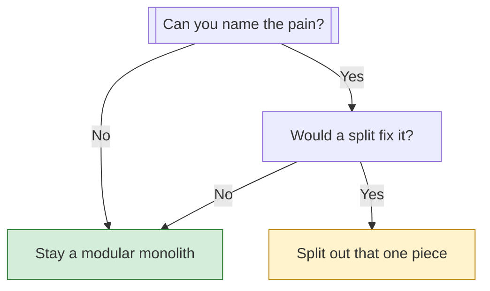

# Keep the monolith, but make it modular

---

Keep the monolith (one app, deployed as one unit), organize its insides into clear modules, and split out a service only when you can name the specific pain it fixes. Full microservices (many small services, each deployed on its own and owning its own data) would cost a team of six far more than 40k daily users could justify.

Map: 1 your load, 2 what a split costs, 3 when one split is right, 4 what to do now.

---

## 1. 📊 Your load is small

Take an illustrative guess: each user makes 50 requests a day. That's 40,000 × 50 = 2 million requests a day, or about 23 per second on average. Even at 10× that at peak, it's around 230 per second. A single app with a decent database commonly handles this, so scaling isn't your bottleneck.

> 🙋 **Then why do companies split into services at all?**

Two reasons. One is load: parts of the system need to scale independently. The other is people: dozens of engineers block each other's releases in one codebase. Six people sharing one codebase usually have neither problem.

---

## 2. ⚖️ A split costs more than it looks

Legend: ✅ fits your situation, ⚠️ fits only with a reason, ❌ costly for six people.

| | Monolith | Two services | Full microservices |
|---|---|---|---|
| **Deployables** | ✅ One | ⚠️ Three | ❌ One per service |
| **Failure modes** | ✅ Mostly in-process | ⚠️ A few network paths | ❌ Many network paths |
| **Ops work per person** | ✅ Low | ⚠️ Moderate | ❌ High |
| **Fit for six people** | ✅ Yes | ⚠️ If justified | ❌ No |

The obvious plan is "split by feature so people move faster." It fails here because six people rarely block each other, yet you still pay for every network call.

Run one example through all three options. Say a customer places an order, and the app must charge the card and reserve stock.

**Checkout when orders, payments and inventory are separate services**

Watch the last arrow: the card is charged, then the stock call times out. In a monolith, both steps sit inside one database transaction (a group of writes that all succeed or all roll back), so this half-finished state can't exist. Across services you must write undo steps (called compensating actions) for every such gap.

> 🧠 **Think of it like:** one kitchen versus a separate kitchen for each dish, with couriers carrying food between them. A six-person restaurant gains little from that. The comparison breaks at failure: a lost courier is visible, but a network call can fail silently or half-succeed.

---

## 3. 🔀 One split is right only for a named pain

Legend: green is stay put, yellow is split with care.

A split earns its cost when it removes a concrete problem. Examples are a CPU-heavy job slowing checkout, a part that needs a different runtime or language, or a part that must be walled off for security.

Notice the second check. Many pains, like a slow report job, are fixed by running that job in a separate worker process from the same codebase. That gives you the isolation without a new service to own, deploy and monitor.

---

## 4. 🛠️ What to do now

1. **Draw module boundaries inside the app.** Make orders, payments and inventory separate modules with small interfaces, and forbid one module from reading another's tables.
2. **Move slow jobs to a background worker.** Use the same codebase and the same database, so there's no network call to fail.
3. **Measure before you decide.** Add metrics and error tracking, then run a load test to find your real limit instead of a guessed one.
4. **Write down your triggers.** For example: two teams repeatedly blocking each other's deploys, or one part needing to scale 10× on its own. Revisit the question only when one fires.

Clean boundaries make a later split a matter of moving a module out, not untangling a knot. That's why the modular step is cheap insurance.

> **For implementers:** enforce boundaries with package or namespace rules and a lint check in CI, and give each module its own database tables or schema, even if they share one database server.

I don't know your product's pain points. If a specific part hurts (slow jobs, risky deploys, one hot endpoint), that could change the answer for that part.

---

> 🎯 **Takeaway:** small load + small team → one deployable; split only for a named pain → modular monolith first, then at most one extraction.

> 🧪 **Check yourself:** A nightly report job slows checkout. What's the cheapest first fix?
> - A) Build a new microservice for reports
> - B) Run the job in a background worker from the same codebase
> - C) Rewrite the report code in another language
>
> **Answer:** B. It isolates the load without adding network calls, a new deployment, or a second data owner.
