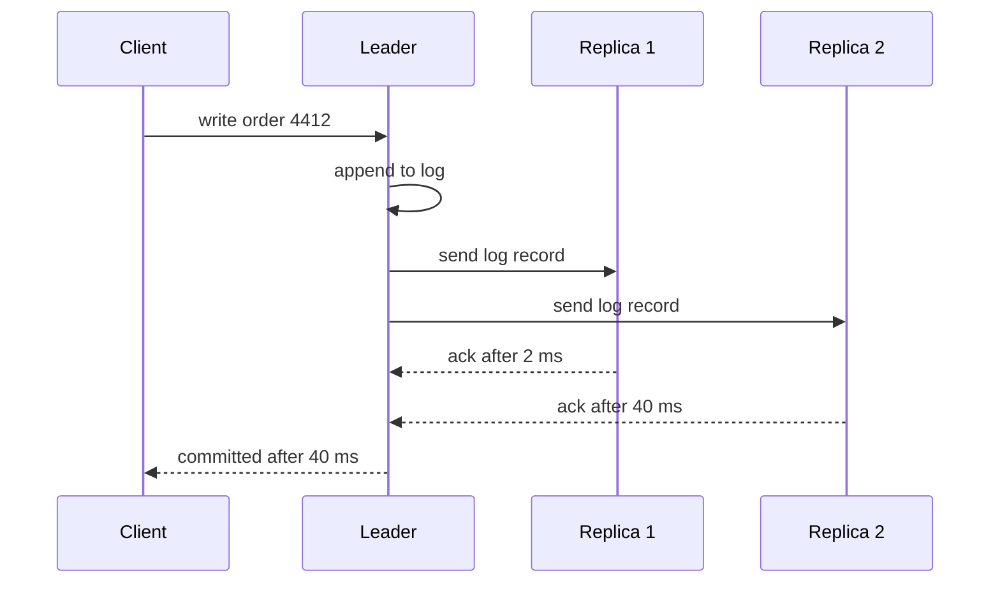

# Why more replicas can slow writes down

Writes slow down because a database that waits for replicas to confirm each write must wait for the slowest confirmation it needs, and every replica you add gives that wait another chance to be long. Replicas also add no write capacity, because each one repeats every write.

**The chain, in short:**

Write arrives → leader logs it → leader sends it to every replica → leader waits for acknowledgements (acks) → commit and reply

Here are four sections: 1) what a write waits for, 2) why waiting gets worse with more replicas, 3) why replicas don't share the work, 4) when it doesn't happen.

---

## 1. ⏱️ What one write waits for

Say you run a database with one leader (the server that accepts writes) and a few replicas (copies that receive every change). In synchronous replication (the leader confirms a write only after replicas confirm they have it), the client's write is not done when the leader finishes. It's done when enough replicas have said "got it."

Here is the order of events, with illustrative timings:



The diagram shows the leader sending to both replicas at once. Notice that the client's wait is set by the slower ack (40 ms), not the average.

> 🙋 **Why not send the write to one replica and tell the client right away?**

You can, and that's asynchronous replication. The cost is that if the leader dies before the replicas catch up, the client was told "saved" about data that now exists nowhere else. Synchronous replication closes that gap by making the client wait.

---

## 2. 🔀 Why each extra replica adds waiting

Three effects stack up as you add replicas.

1. **More chances for a slow ack.** Each replica sometimes stalls on a disk flush, a garbage collection pause, or a congested network link. Say any given replica is slow on 1% of writes. If the leader must wait for all of them, the chance a write hits at least one slow replica grows quickly:

```
Replicas   Chance a write waits on a slow one
 1         █            1.0%
 3         ███          3.0%
 5         █████        4.9%
10         ██████████   9.6%
```

The bars show that the typical write barely changes, but the slow tail (the worst few percent of writes) gets fatter. Users feel the tail.

2. **More work for the leader.** The leader sends each log record once per replica, so ten replicas mean ten sends and ten acks to process. Its network and CPU can become the bottleneck.

3. **Locks are held longer.** A transaction usually keeps its row locks until commit. If commit waits 40 ms instead of 2 ms, other writes to the same rows queue behind it, and the delay compounds.

Quorum systems (where a majority of replicas must ack) soften effect 1 but don't remove it. Going from 3 to 5 nodes raises the majority from 2 to 3, so the leader waits for the second-fastest follower instead of the fastest.

| Replication mode | What the leader waits for | Slowdown from more replicas |
|---|---|---|
| ✅ Asynchronous | Nothing | None at commit |
| ⚠️ Quorum | k-th fastest ack | Grows slowly |
| ❌ Wait for all | Slowest ack | Grows fastest |

Legend: ✅ no added commit wait, ⚠️ waits on a middle ack, ❌ waits on the slowest.

---

## 3. 📊 Why replicas don't share the write load

> 🙋 **If I have ten machines, why can't they split the writes?**

Because a replica is a full copy. For the copy to stay correct, it must apply every write the leader accepts. Ten replicas means every write is performed eleven times, so total write work rises while write throughput of the leader stays capped.

Replicas help **reads**, since any copy can answer a read. To scale writes, you split the data itself (sharding, meaning each node owns a slice of the data), so each write lands on one shard.

> 🧠 **Think of it like:** a contract that needs every partner's signature. Each added partner makes the slowest signer matter more, and each partner still has to sign every page. The analogy breaks down for quorum systems, where only a majority must sign.

---

## 4. ⚖️ When it doesn't happen

- **Asynchronous replication** doesn't slow commits, though many replicas can still strain the leader's network and make the replicas lag further behind.
- **Multi-leader or leaderless designs** have different costs, mainly conflict resolution when two nodes accept writes to the same data.
- **Fast, similar replicas** in the same data center show the effect less than replicas across regions.

I'm describing the general mechanism. The exact numbers depend on your database and its settings.

> 🎯 **Takeaway:** more replicas → more acks to wait for and more chances of a slow one → fatter write tail, and no extra write capacity.

> 🧪 **Check yourself:** A leader needs acks from all replicas. Going from 3 to 10 replicas most directly changes which of these?
> - A) Read capacity only
> - B) The chance a write waits on a slow replica
> - C) The size of each write
>
> **Answer:** B. Each replica adds another chance of a stall, and the leader waits for the slowest one. A is a benefit of replicas, but it isn't what slows writes.

I can turn this into an interactive version where you drag the replica count and watch the slow-write chance move, if you'd like.
