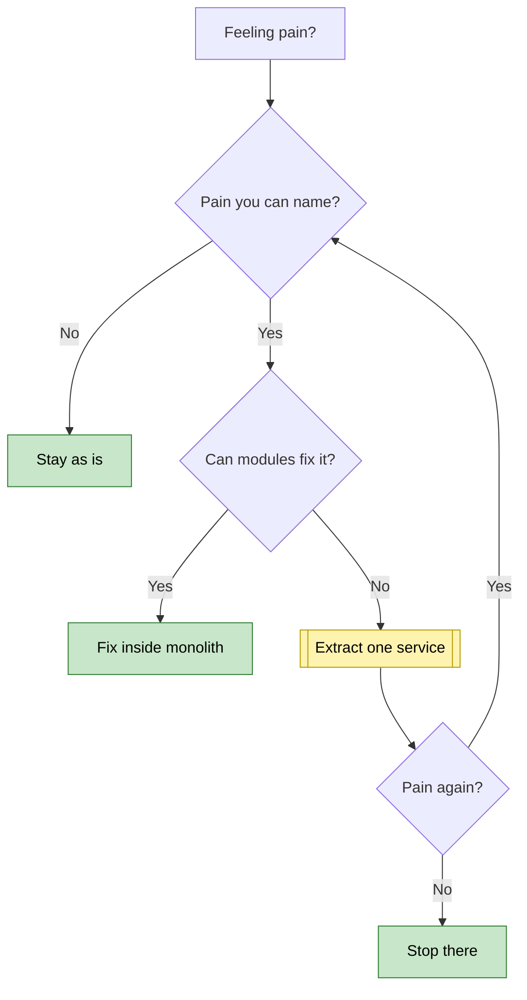

# Keep the monolith, but make it modular

---

Keep the monolith (one app you deploy as a unit) and enforce clear internal boundaries. Split out a service only when you can name a specific pain that modules can't fix. For six engineers and 40k daily users, full microservices cost more than they return.

Three sections follow: what your load needs, what each option costs, and when to split.

---

## 1. 📊 Your load doesn't force a split

Say your nightly report export eats memory at 2 a.m. and slows the web app. That feels like a reason to split. Check the load first.

Take 40k daily users making about 50 requests each (an illustrative guess). That's roughly 2 million requests a day, or about 23 per second on average. Even a 10× peak is a few hundred per second, which a well-tuned monolith on modest hardware handles.

> 🙋 **Doesn't the export problem justify a service anyway?**

Not yet. You can run the same codebase as a second process that only handles background jobs. The export no longer competes with web requests, and you still have one repo, one deploy, and one database.

---

## 2. ⚖️ What each option costs a team of six

Each service you add brings its own deploy pipeline, monitoring, and failure modes. A call between services can time out, while a function call can't. A change that spans two databases (a distributed transaction) becomes hard.

🟢 means cheap, 🟡 moderate, 🔴 expensive. The same marks are used in the chart in section 3.

| Option | Deployables | Ops burden | Fit for six |
|---|---|---|---|
| Monolith | 1 | 🟢 low | 🟢 strong |
| Two services | 3 | 🟡 moderate | 🟡 only with a reason |
| Full microservices | 10 or more | 🔴 high | 🔴 weak |

Here is how thinly your team spreads. These counts are illustrative:

**Engineers per deployable**
```
Monolith (1)               ██████████████████████ 6.0
Two services (3)           ███████ 2.0
Full microservices (~12)   ██ 0.5
```

With full microservices, you'd have more deployables than people. Someone would spend most of their week on pipelines and on-call rather than on the product.

> 🧠 **Think of it like:** a six-person restaurant kitchen. One kitchen with stations works well. Twelve separate kitchens each need their own manager and a runner between them, and the runner can get lost. The analogy stops at data: separate kitchens don't need to agree on one inventory count, but your services often do.

---

## 3. 🔀 When splitting is right

Split because of a pain you can name, not because of a trend. This chart shows the order of questions.

The double-bordered box is the one real extraction. Green boxes cost little, and the yellow box costs more.



Pains that justify extraction are specific:
- **Different scaling profile.** One part needs many more machines than the rest.
- **Different runtime.** For example, a Python ML model next to a Rails app.
- **Team collision.** Two groups keep blocking each other's deploys. At six people, this is rare.

In your export case, a background worker fixes the memory problem. If the export later needs its own hardware and its own release cadence, that becomes your first extraction, and it's the same as the "two services" option.

> 🙋 **Won't we have to rewrite everything later?**

No, if you keep the boundaries real now. Give each module its own folder and a public interface, and forbid modules from reading each other's database tables. Extracting a module like that means moving a folder behind a network call, not untangling the app.

---

## 4. 🚀 What to do this quarter

1. **Draw module boundaries.** Pick four to six domains, such as billing, accounts, and reports. Each gets a public interface.
2. **Enforce them in CI.** Use a dependency-check tool for your language so a cross-module import fails the build.
3. **Move heavy work to a worker.** Run the same codebase as a second process fed by a job queue.
4. **Invest in observability.** That means logs, metrics, and traces. You'll need them whether or not you ever split.
5. **Set a review trigger.** Revisit the question when a named pain appears, or when the team passes about 15 engineers.

**I can't see your actual pain.** If you tell me what's hurting now, such as slow deploys, one hot component, or compliance isolation, I can tell you whether it changes this answer.

> 🎯 **Takeaway:** Named pain → can modules fix it? → if not, extract one service → stop. Otherwise stay modular.
