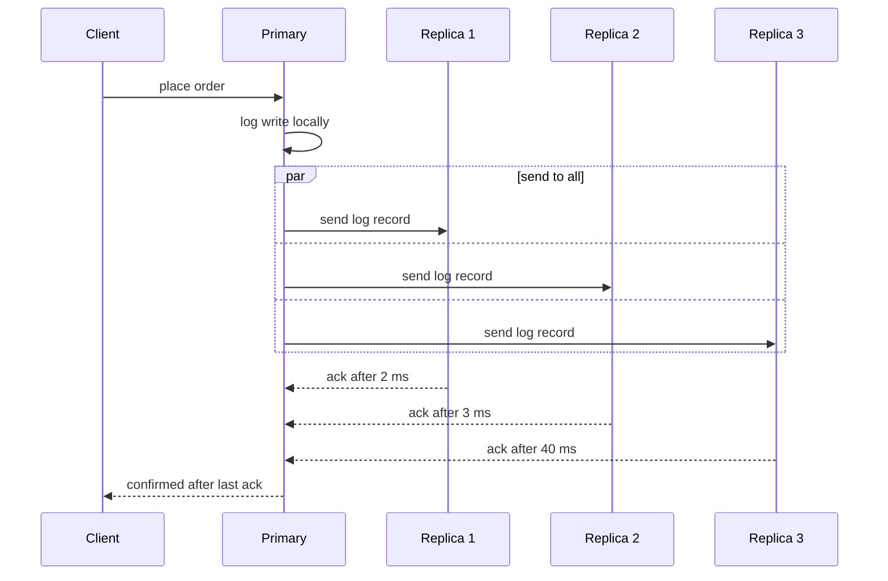

# Why more replicas can slow down writes

---

Every replica has to receive and apply every write, and a write usually can't finish until some or all replicas confirm it. Each extra replica adds another confirmation to wait for and more work for the primary (the node that accepts writes). So write latency tends to rise while write throughput stays flat. **Replicas scale reads, not writes.**

I'll follow one example: a shop's `orders` table, where a customer's order is one small write. Latencies below are illustrative. The map: 1) what a replica does, 2) why the write waits, 3) why the slowest replica matters, 4) the primary's extra work, 5) distance.

---

## 1. 🔁 A replica repeats the work, it doesn't share it

You might expect three copies of the database to split the write load three ways. They don't. Each replica applies the same stream of writes as the primary.

**Say the shop takes 1,000 orders per second:**

| Setup | Writes each node applies | Read capacity |
|---|---|---|
| 1 node | 1,000/s | 1× |
| 3 nodes | 1,000/s | about 3× |
| 5 nodes | 1,000/s | about 5× |

Writes cost the same on every node, and read capacity is the only column that grows. More nodes add no write capacity, only more coordination.

> 🙋 **Why wait for replicas at all? Why not reply to the customer right away?**

You can. That's *asynchronous replication* (the primary confirms without waiting for copies). It's fast, but if the primary dies before copying the order, the customer was told "confirmed" for an order that no longer exists. Systems that can't accept that loss wait for replicas first.

---

## 2. ⏱️ The write waits for the copies

Here is one order with *synchronous replication* (the primary waits for replicas before confirming).

**The sequence for one order write:**



The sends run in parallel, so latency isn't the *sum* of the replicas. It's the time of the slowest one you wait for. Replica 3's 40 ms sets the customer's wait, even though two replicas answered in a few milliseconds.

The wait depends on how many acks you require:

| Mode | Waits for | Speed | Safety |
|---|---|---|---|
| Async | no replica | ✅ fastest | ❌ can lose writes |
| Quorum (majority) | majority of nodes | ⚠️ middle | ✅ survives failures |
| Sync to all | every replica | ❌ slowest | ✅ strongest |

Status legend: ✅ good, ⚠️ trade-off, ❌ weak.

> 🧠 **Think of it like:** a group chat where you can't send your next message until everyone reacts with a thumbs-up. Each person you add is another person who might be away from their phone. **Where it breaks down:** real replicas confirm at the same time, so you wait for the slowest person, not for everyone one after another.

---

## 3. 📊 More replicas means a worse slowest replica

Replicas sometimes stall. A disk hiccup, a garbage-collection pause or a busy network can each do it. Say each replica is slow on 1% of writes (illustrative). If you wait for all of them, the chance that *some* replica is slow grows with the count.

**Chance that a write hits at least one slow replica:**

```
1 replica   █                      1.0%
3 replicas  ███                    3.0%
5 replicas  █████                  4.9%
10 replicas ██████████             9.6%
```

At 10 replicas, nearly one write in ten pays the slow-replica penalty. The average latency barely moves, but the *tail latency* (the slowest few percent of requests) gets much worse. The customers who hit it notice.

**Quorum is a partial fix, with its own cost.** With 3 nodes you need 2 acks. With 5 nodes you need 3. A quorum ignores the slowest few replicas, but the majority you wait for gets larger as the cluster grows. Whether latency rises or falls depends on the setup, but throughput doesn't improve.

---

## 4. 🔌 The primary does more work per write

The primary has to send each write to every replica. That costs network bandwidth, CPU, and per-replica bookkeeping. At 1,000 orders per second with 5 replicas, it sends 5,000 copies per second on top of its own work.

If the primary is already near its limit, this extra work slows the *original* write too. Writes queue up behind replication traffic.

> **For implementers:** in PostgreSQL, each streaming standby gets its own WAL sender process on the primary (WAL is the write-ahead log of changes). In Raft-style systems (a consensus protocol), the leader sends each log entry to every follower. In both, replica count adds fan-out work on one node.

---

## 5. 🌍 Distance sets the floor

A replica in another region adds a network round trip to every synchronous write. Say your primary is in one country and a replica sits 150 ms away (illustrative). Every confirmed order now takes at least 150 ms, whatever the hardware.

Adding a far replica "for safety" can therefore slow every write, even though the nearby replicas are fast.

---

## What people do instead

- **Keep sync replicas few.** Wait for one or two nearby replicas, and let far or extra replicas copy asynchronously.
- **Use replicas for reads.** Offload reporting and read-heavy queries from the primary.
- **Scale writes differently.** *Sharding* (splitting data across independent primaries) is the usual way to grow write capacity.

---

> 🎯 **Takeaway:** more replicas → more acks to wait for and more copies to send → slower slowest-case write, same write capacity.

> 🧪 **Check yourself:** You go from 3 to 6 replicas and your write-latency tail gets worse, but read throughput doubles. Which of these explains the tail?
> - A) Reads are stealing write capacity
> - B) The write waits on more replicas, so a slow one is more likely
> - C) Each replica now stores less data
>
> **Answer:** B. The write waits on more replicas, so a slow one is more likely to set its latency. Read throughput is unrelated to that wait.

I can turn this into an interactive version where you change the replica count and slow-replica chance and watch the latency tail move.
