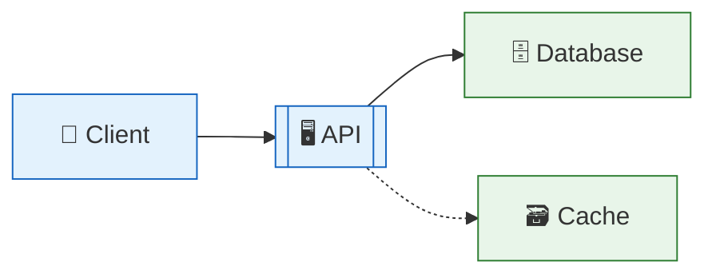

# Emoji palette and colour coding

The icon set to draw bullet points, headings, labels and status marks from, plus the
three ways markdown can actually carry colour.

`SKILL.md` carries the working set — the twenty or so icons that cover most answers.
Read this file when the working set has nothing that matches the meaning, or when an
answer needs colour.

**One rule governs all of it:** the icon matches the meaning, and the same icon means
the same thing all the way through one answer. An icon that could be swapped for any
other is decoration, so pick a different one or drop it.

## Contents

1. How to pick
2. Core concepts and thinking
3. Mechanism, process and flow
4. Data and storage
5. Network, services and messaging
6. Code, build and tooling
7. Time, speed and scale
8. Problems, risk and security
9. People, teams and process
10. Status marks
11. Numbers, order and navigation
12. Colour in markdown
13. What not to do

## 1. How to pick

- 🎯 Ask what **kind** of thing the bullet is, not what topic it belongs to.
- 🔁 Reuse the icon you already used for that kind of thing in this answer.
- 🚫 Skip the icon when nothing fits. A plain bullet beats a wrong icon.
- 📏 One icon per bullet, at the front, then a space, then the words.

## 2. Core concepts and thinking

| Icon | Means |
|---|---|
| 🧠 | A concept, a mental model, memory |
| 💡 | The key insight, the thing to take away |
| 🎯 | The goal, the point, what we are aiming at |
| 🔑 | The one fact the rest depends on |
| 📖 | A definition, a term being introduced |
| 🧩 | A piece of a larger whole |
| ❓ | An open question, something unknown |
| 🤔 | A judgement call, a tradeoff to weigh |
| ⚖️ | A tradeoff with two sides |
| 🧭 | A rule of thumb, how to decide |
| 🗺️ | An overview, the lay of the land |
| 🪞 | A comparison, two things side by side |
| 🧪 | An experiment, a test, a hypothesis |
| 📐 | A measurement, a precise definition |

## 3. Mechanism, process and flow

| Icon | Means |
|---|---|
| ⚙️ | A mechanism, how the thing works inside |
| 🔄 | A state change, a transition, a loop |
| ➡️ | A step forward, "then this happens" |
| 🔀 | A branch, a choice between paths |
| 🔗 | A link, a dependency, a connection |
| 🏭 | Something that produces or generates |
| 🧵 | A thread, a concurrent path |
| 🚦 | A gate, a check that blocks or allows |
| 🪝 | A hook, a callback, an interception point |
| 🧮 | A calculation, a computation step |
| 📤 | Output, something leaving |
| 📥 | Input, something arriving |
| ♻️ | Reuse, recycling, pooling |
| 🪄 | Something that happens automatically |

## 4. Data and storage

| Icon | Means |
|---|---|
| 🗄️ | A database, persistent storage |
| 💾 | A write to disk, durability |
| 🗃️ | A cache, an index, a lookup table |
| 📦 | A record, a payload, a package |
| 🧊 | Cold storage, archived data |
| 🔥 | Hot data, what is accessed often |
| 📊 | A comparison, a metric, a chart |
| 📈 | Growth, something increasing |
| 📉 | Decline, something decreasing |
| 🧾 | A log, an audit trail, a ledger |
| 🪣 | A bucket, a partition, a shard |
| 🔖 | A key, an identifier, a pointer |
| 🗂️ | A schema, a structure, an organisation |

## 5. Network, services and messaging

| Icon | Means |
|---|---|
| 🌐 | The network, the internet, a public surface |
| 📡 | Signalling, broadcast, a message in flight |
| 🖥️ | A server, a node, a host |
| 📱 | A client, a device, a consumer |
| 🔌 | An API, an interface, a plug point |
| 📨 | A single message, a request |
| 📬 | A queue, a mailbox, a buffer |
| 🚚 | Delivery, transport, a shipment of data |
| 🧱 | A service boundary, an isolation wall |
| 🏗️ | Architecture, how components are arranged |
| 🪢 | Coupling between two parts |
| ✂️ | A split, a partition, a network cut |
| 👂 | A listener, a subscriber, a consumer |

## 6. Code, build and tooling

| Icon | Means |
|---|---|
| 💻 | Code, an implementation |
| 🛠️ | A tool, a command, an operation to run |
| 🧰 | A library, a toolkit, a dependency |
| 🏷️ | A version, a tag, a label |
| 🧹 | Cleanup, refactoring, removal |
| 🪛 | A setting, a flag, a knob to turn |
| 🧪 | A test |
| 🚀 | A deploy, a release, going live |
| 📝 | A config file, a document, a spec |
| 🔧 | A fix, a patch |
| 🪤 | A gotcha, an easy mistake to make |

## 7. Time, speed and scale

| Icon | Means |
|---|---|
| ⏱️ | Latency, how long something takes |
| ⏳ | Waiting, blocking, a timeout |
| ⚡ | Speed, a fast path, performance |
| 🐢 | A slow path, the bottleneck |
| 📅 | Scheduling, ordering in time |
| 🔂 | A retry, a repeat |
| 🧯 | Backpressure, throttling, a limit |
| 🏔️ | Scale, high volume, peak load |
| 🪶 | Something cheap, light, low cost |
| 🧱 | A hard limit, a wall you hit |

## 8. Problems, risk and security

| Icon | Means |
|---|---|
| ⚠️ | A caution, something to watch |
| 💥 | A failure, a crash, a break |
| 🐛 | A bug, a defect |
| 🕳️ | A gap, something missing |
| 🌩️ | An outage, an unpredictable failure |
| 🛡️ | Security, a defence, a guarantee |
| 🔐 | Encryption, authentication, a secret |
| 🚨 | An alert, an urgent problem |
| 🧨 | A risk, something that could go badly |
| 🩹 | A workaround, a partial fix |
| 🔍 | Debugging, investigation, inspection |
| 🧷 | A safety mechanism, a fallback |

## 9. People, teams and process

| Icon | Means |
|---|---|
| 👤 | One user, one actor |
| 👥 | A team, several actors |
| 🙋 | A request from a person |
| 🗣️ | Communication between people |
| 📋 | A checklist, a procedure |
| 🤝 | An agreement, a contract, a convention |
| 🎓 | Learning, onboarding, skill |
| 💰 | Cost, money, budget |
| ⏰ | A deadline, time pressure |

## 10. Status marks

Use these for status only, never as a topic icon. A list or table that uses them
should use at least two different ones, so the contrast carries meaning.

| Icon | Means |
|---|---|
| ✅ | Works, supported, done, safe |
| ❌ | Broken, unsupported, not done, unsafe |
| ⚠️ | Works with a caveat |
| 🟢 | Good, on the best end of a scale |
| 🟡 | Middling, acceptable |
| 🔴 | Bad, on the worst end of a scale |
| ⬆️ | Better, higher, increased |
| ⬇️ | Worse, lower, reduced |
| ➖ | No change, neutral |
| 🚧 | In progress, partial, not finished |

## 11. Numbers, order and navigation

| Icon | Means |
|---|---|
| 1️⃣ 2️⃣ 3️⃣ 4️⃣ 5️⃣ | A step in a short sequence, where plain numbering would be heavier |
| ▶️ | Start here |
| ⏹️ | The end state |
| 🔼 🔽 | Up and down a hierarchy |
| ↩️ | A return, a rollback, going back |
| ⤴️ | An escalation, a path upward |

## 12. Colour in markdown

Markdown has **no text colour**. These three techniques are what actually renders in
colour, and nothing else does.

### 🎨 A `diff` fence — red and green

Lines starting with `-` render red and `+` render green in most viewers. Best for a
before and after, or a broken and fixed pair.

```diff
- cache.set(key, value)        # write stays in memory, lost on crash
+ cache.set(key, value, sync=True)  # write reaches disk before returning
```

### 🎨 Mermaid `classDef` — real colour in a diagram

One colour code per answer, named once before the first coloured diagram, then
reused.



Blue is the request path, green is storage.

### 🎨 Status emoji — colour in lists and tables

🟢 🟡 🔴 and ✅ ❌ ⚠️ are the only way to put colour in a table cell or a bullet.

| Option | Speed | Durability |
|---|---|---|
| Write-through | 🟡 Slower writes | ✅ Survives a crash |
| Write-back | 🟢 Fast writes | ❌ Can lose the last write |

## 13. What not to do

- 🚫 The same icon on every bullet. That is a bullet character, not a signal.
- 🚫 An icon that does not match the meaning, picked because the bullet looked bare.
- 🚫 An icon inside code, a command, an identifier, JSON, a log line or a file path.
- 🚫 Icons in a formal document, a legal or medical answer, or a one-line reply.
- 🚫 Two different icons for the same kind of thing in one answer.
- 🚫 A status mark used as a topic icon, or a topic icon used to mean good or bad.
