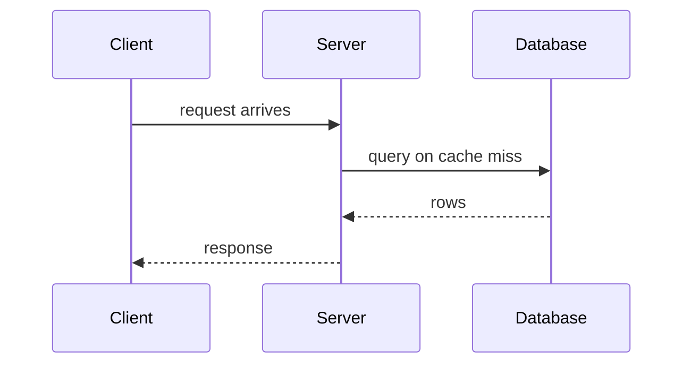

# Explanation examples

Each pair shows a weak explanation, a better one, and what specifically changed.
Each longer "better" answer is complete and sits in a fenced block, laid out in the
page shape from `SKILL.md`: the page shape is fixed; the wording never is. The
follow-up and the last sections show answers that stay short, and requests where
the right move is to add nothing.

## Contents

<!-- op:sequencing,mechanism -->
- Software engineering: why a connection pool speeds up a web app
- Computer science: why hash-table lookup is constant time on average
<!-- /op:sequencing,mechanism -->
<!-- op:sequencing -->
- Mathematics: what a derivative is
<!-- /op:sequencing -->
<!-- op:sequencing,examples -->
- Mathematics: why dividing by a fraction means multiplying by its reciprocal
<!-- /op:sequencing,examples -->
<!-- op:mechanism -->
- Everyday: why a pressure cooker cooks faster
- Code: explaining a debounce function
<!-- /op:mechanism -->
<!-- op:register -->
- Calibration: one question, two readers
<!-- /op:register -->
- Follow-up confusion: repairing one link
<!-- op:visual -->
- Visual forms: flow, contrast, proportion, change over time, order in time,
  differentiated parts, two states, specimens, scannable tables, a checkable
  question
- Restraint: no visual, and no artifact unless asked
- Opt-in: one artifact when the person asks
<!-- /op:visual -->
- Restraint: requests where the skill should add nothing

<!-- op:sequencing,mechanism -->
## Software engineering: connection pools

**User (backend developer):** Why does using a database connection pool make my
web app faster?

**Weak:**
> A connection pool maintains a cache of database connections that can be
> reused, reducing overhead and improving performance and scalability. You can
> configure the minimum and maximum pool size, idle timeouts, and connection
> validation.

**Better:**

````markdown
# Why a connection pool makes your app faster

---

Opening a database connection costs more than running a typical query, and without a pool your app pays that cost on every request. A pool opens connections once and lends them out, so the setup is paid once per connection instead of once per request.

The answer covers three steps: 1 · what a new connection costs, 2 · how the pool reuses it, 3 · the limit the pool sets.

---

## 1. ⏱️ A new connection is expensive

To open a connection, the client and server set up a network link, often with TLS (encryption for the link), and authenticate. The database then allocates resources for the session, and in PostgreSQL each connection gets its own server process.

If every request opens and closes its own connection, that setup can take longer than the query itself.

---

## 2. 🔄 The pool reuses open connections

A request now does four things in turn: borrow a connection → run its queries → hand it back → the next request reuses it.

The setup cost is paid once per connection instead of once per request. That saving is the whole speed-up.

---

## 3. ⚖️ The pool also sets a limit

The same mechanism caps how many connections exist. When all of them are busy, a new request waits for one to come back, so a pool that is too small becomes a queue.

A pool that is too large has the opposite problem: it can overload the database with more concurrent sessions than it handles well.
````

**What changed:**
- The problem (per-request setup cost) comes before the solution.
- "Reduces overhead" is replaced by the actual chain: borrow, reuse, cost paid
  once per connection.
- The tradeoff follows from the mechanism instead of appearing as a list of
  configuration knobs nobody asked about.
- The layout: a `#` title, a two-sentence answer, a map, and one `##` section per
  step, with `---` between them.
<!-- /op:sequencing,mechanism -->

<!-- op:sequencing,mechanism -->
## Computer science: hash-table lookup

**User (CS student):** Why is hash-table lookup O(1)? Doesn't it still have to
search?

**Weak:**
> Hash tables use a hash function to map keys to array indices, giving O(1)
> average-case lookup. Collisions are handled by chaining or open addressing.
> The worst case is O(n).

**Better:**

````markdown
# Why hash-table lookup is constant on average

---

A hash table never searches for a key: it computes where the key lives and reads that one slot. The computation takes the same time however many items the table holds, which is why lookup is O(1) (constant time) on average.

The answer covers three steps: 1 · the array property it rests on, 2 · how a key becomes a slot, 3 · why the guarantee says average.

---

## 1. 🔑 Arrays give direct access

It rests on one property of arrays: if you know an element's index, you can read it directly, because its address is computed from the index. Nothing is searched.

---

## 2. 🧮 A key becomes a slot number

A hash function (arithmetic that turns keys into numbers) maps "alice" to a number, and that number, reduced modulo the array size, picks a slot. To find "alice" later, you repeat the same computation and go straight to the same slot.

The path is the same every time: "alice" → hash → number → slot → read.

---

## 3. 💥 Collisions explain "average"

Two keys can land in the same slot, which is called a collision. That slot then holds several entries, which must be checked one by one.

If the table resizes before it fills and the hash spreads keys evenly, each slot holds very few entries, so lookups stay constant on average. The table shows what changes when they don't.

| Case | Entries in the slot | Lookup cost |
|---|---|---|
| Typical | One or two | Constant |
| Many collisions | Most of the keys | Grows with n |

Many collisions come from a poor hash or adversarial input (keys chosen to collide). That is the O(n) worst case (time growing with item count).
````

**What changed:**
- The prerequisite the question hinges on (arrays give direct access by index)
  comes first and answers "doesn't it have to search?".
- Each step from key to slot is stated, so O(1) follows instead of being
  asserted.
- Collisions are introduced where they explain the word "average", not as a
  detached list of strategies.
- The layout: a `#` title, a two-sentence answer, a map, `##` sections, and a
  small table for the two cases.
<!-- /op:sequencing,mechanism -->

<!-- op:sequencing -->
## Mathematics: what a derivative is

**User (adult returning to maths):** What actually is a derivative?

**Weak:**
> The derivative of f at x is defined as the limit as h approaches 0 of
> (f(x + h) − f(x)) / h. It represents the instantaneous rate of change, or the
> slope of the tangent line.

**Better:**

````markdown
# What a derivative measures

---

A derivative is how fast something is changing at one instant: the value an average rate of change settles towards as you measure it over shorter and shorter intervals. On a graph, it is the slope of the curve at that point.

The answer builds it in three steps: 1 · average speed, 2 · shrinking the window, 3 · the formula.

---

## 1. 📈 Start with average speed

If a car covers 120 km in 2 hours, its average speed is 120 ÷ 2 = 60 km/h: the change in distance divided by the change in time. That average can hide a lot, because the car may have sped up and slowed down.

---

## 2. ⏳ Shrink the window

To pin down the speed at one moment, take the average over a shorter and shorter window around it: the last minute, the last second, the last millisecond. As the window shrinks, the averages settle towards a single value, and that value is the speed at that instant.

The illustrative figures below are for a car passing one point on the road.

| Window | Distance covered | Average speed |
|---|---|---|
| 1 minute | 1.05 km | 63 km/h |
| 1 second | 18.3 m | 65.9 km/h |
| 1 millisecond | 18.33 mm | 66.0 km/h |

---

## 3. 📝 The formula writes the procedure down

The formula is the limit of `(f(x + h) − f(x)) / h` as `h → 0`, and it records exactly this procedure.

The top, `f(x + h) − f(x)`, is the change, `h` is the window, and `h → 0` is the shrinking. The derivative exists when those averages approach a single value, as they do for smooth curves.
````

**What changed:**
- The formal definition depends on two ideas, average rate and shrinking the
  interval. Each is now in place before the formula appears.
- The formula is introduced last and each part is mapped to the idea it encodes.
- The layout: a `#` title, the answer in two sentences, a map, one `##` section per
  idea, and a table that shows the averages settling.
<!-- /op:sequencing -->

<!-- op:sequencing,examples -->
## Mathematics: dividing by a fraction

**User:** Why does dividing by a fraction mean you flip it and multiply?

**Weak:**
> Dividing by a fraction is the same as multiplying by its reciprocal, so
> a ÷ (b/c) = a × (c/b). Remember: keep, change, flip.

**Better:**

````markdown
# Why dividing by a fraction flips it

---

Division asks how many of one thing fit into another, and with a fraction that count takes two moves. Multiplying by the bottom number counts the small pieces, and dividing by the top number groups them, which together is "flip and multiply".

The answer works it out in two steps: 1 · quarters, 2 · three-quarter pieces.

---

## 1. 🧮 How many quarters fit into 3

6 ÷ 2 asks how many 2s fit into 6, and 3 ÷ ¼ asks how many quarters fit into 3. Each whole holds 4 quarters, so 3 wholes hold 3 × 4 = 12, and dividing by ¼ became multiplying by 4.

---

## 2. 🧩 Bigger pieces need one more move

Now try 3 ÷ ¾, with pieces three times as big as a quarter. There are still 12 quarters in 3, but each piece uses 3 of them, so there are 12 ÷ 3 = 4 pieces.

The two moves line up with the two halves of the rule.

| Move | Arithmetic | Part of the rule |
|---|---|---|
| Count quarters | 3 × 4 = 12 | Multiply by the bottom |
| Group into threes | 12 ÷ 3 = 4 | Divide by the top |

Together, 3 × 4 ÷ 3 is 3 × 4/3, and that is the flip.
````

**What changed:**
- It starts from what division means, which the rule depends on but never
  states.
- A worked case comes before the general rule, and each step of the case is
  mapped to one half of "flip and multiply".
- The layout: a `#` title, a two-sentence answer, two `##` sections, and a table
  that maps each move to its half of the rule.
<!-- /op:sequencing,examples -->

<!-- op:mechanism -->
## Everyday: pressure cookers

**User:** Why does a pressure cooker cook food faster?

**Weak:**
> A pressure cooker traps steam, which increases the pressure, which raises the
> boiling point of water, so food cooks faster.

**Better:**

````markdown
# Why a pressure cooker cooks food faster

---

Cooking speed depends mainly on temperature, and an open pot can't get water much past 100 °C. A pressure cooker traps the steam, which raises the boiling point to roughly 120 °C, so the food cooks in hotter water.

The chain is four links long: trapped steam → higher pressure → higher boiling point → faster cooking. The answer covers it in three steps: 1 · why an open pot stalls, 2 · how sealing changes that, 3 · the limits that follow.

---

## 1. 🛑 An open pot stalls at boiling

At sea level, water in an open pot can't get much hotter than about 100 °C. Extra heat turns water into steam, which escapes, instead of raising the temperature.

---

## 2. 🔒 Sealing raises the boiling point

A pressure cooker seals the steam in, and the trapped steam raises the pressure. At higher pressure water needs more energy before it can boil, so the boiling point rises to roughly 120 °C in a typical cooker.

The bars compare the water temperature in each pot, scaled to the hotter one.

```
open pot         █████████████████     ~100 °C
pressure cooker  ████████████████████  ~120 °C
```

The food sits about 20 °C hotter, and the changes that make it tender run considerably faster.

---

## 3. ⚖️ The same seal sets the limits

It only speeds up moist cooking, so it can't brown food the way a dry pan does. You also can't check the food mid-cook without first releasing the pressure.
````

**What changed:**
- The weak version states the chain correctly but skips the two links that make
  it make sense: why an open pot is capped at boiling, and why temperature is
  what matters.
- The limits are derived from the mechanism rather than listed.
- The layout: a `#` title, a two-sentence answer, the chain as an inline arrow
  line, and bars for the two temperatures.
<!-- /op:mechanism -->

<!-- op:mechanism -->
## Code: a debounce function

**User:** Explain this and why each part is needed.

```js
function debounce(fn, wait) {
  let timer;
  return function (...args) {
    clearTimeout(timer);
    timer = setTimeout(() => fn.apply(this, args), wait);
  };
}
```

**Weak:** a line-by-line restatement ("declares a variable timer, returns a
function, clears the timeout, sets a timeout…").

**Better:**

````markdown
# What debounce does, and why each part matters

---

`debounce` returns a wrapper that runs `fn` only once calls have stopped for `wait` milliseconds. A search box uses it to query only after the user stops typing.

The answer covers two steps: 1 · the shared timer, 2 · the call that finally fires.

---

## 1. 🔁 The shared timer collapses a burst

`timer` lives outside the returned function, so every call shares it, and that is how one call cancels the run the previous call scheduled. If it were declared inside, each call would get a fresh `timer` and nothing would be cancelled.

- **`clearTimeout(timer)`:** cancels the pending run, so a burst of calls collapses into one run instead of many late ones.
- **`setTimeout(…, wait)`:** schedules a fresh run, so the delay restarts on every call.

---

## 2. ⏭️ The call that finally fires

`fn.apply(this, args)` forwards the latest arguments and the caller's `this`. The arrow function around it keeps `this` from the returned function, so `fn` sees the `this` the caller used.

The table traces three quick calls, 100 ms apart, with `wait` set to 300 ms.

| Time | Event | Pending run |
|---|---|---|
| 0 ms | Call 1 | Due at 300 ms |
| 100 ms | Call 2 cancels it | Due at 400 ms |
| 200 ms | Call 3 cancels it | Due at 500 ms |
| 500 ms | `fn` runs once | None |
````

**What changed:** the parts are explained in the order that makes the behaviour
make sense, and each one is paired with what breaks without it. The layout gives
the purpose first, one `##` section per part of the mechanism, and a table that
traces a burst of calls.
<!-- /op:mechanism -->

<!-- op:register -->
## Calibration: one question, two readers

The same question, from two readers who know different things. Each answer starts
from what that reader already has and teaches only what they are missing.

**Reader A:** "I'm taking an intro databases class. Why does adding an index make
my query faster?" They know tables, rows, and queries. They are missing how a
database finds a row.

**Weak:** "An index is a B-tree that cuts lookups from O(n) to O(log n) by avoiding
a full table scan." Every term in it is one the reader lacks.

**Better:**
> Without an index, the database finds matching rows by reading every row in the
> table, one by one. This is called a *full table scan*. An index is a separate
> list of one column's values, kept sorted, each pointing to its row. Because the
> list is sorted, the database jumps straight to the value, the way you use the
> index at the back of a book instead of reading every page.

**Reader B:** "I've written Go backends for years but never looked inside a
database. Why does adding an index make my query faster?" They know big-O, binary
search, and sorted slices. They are missing what the database does without an
index and what the index is. Whether they know a disk page is uncertain.

**Weak:** the Reader A answer, book and all, which re-teaches sorting to someone
who has written binary search. Also weak: "the planner switches to an index scan
once selectivity beats sequential I/O", which assumes the database internals they
said they lack.

**Better:**
> Without an index, `WHERE email = ?` runs a full table scan: the database reads
> every row, so the cost is O(n). An index on `email` is usually a B-tree, a
> balanced search tree sorted by that column. A lookup walks down it the way a
> binary search halves a sorted slice, but with hundreds of branches per step, so
> it costs O(log n). Each node fills one page (the block read from disk at once),
> so finding one row among millions typically reads three or four pages.

**What changed:**
- Each answer starts from the nearest idea its reader knows: a book's index for A,
  binary search for B.
- B gets no definition of big-O or sorting, and the uncertain term, page, gets a
  gloss in place rather than a question.
- Both answers stay at one short paragraph. Calibration changes which ideas get
  the words, not how many words there are.
<!-- /op:register -->

## Follow-up confusion: repairing one link

**Context:** an earlier answer explained that 3 ÷ ¾ = 4 by counting the 12
quarters in 3 and grouping them.

**User:** I get the quarters part, but why do we divide by 3 at the end?

**Weak:** re-explaining the whole method from the definition of division.

**Better:**
> Because each piece we're counting is ¾ in size, and so is made of 3 quarters.
> We found 12 quarters in total; putting them into groups of 3 gives 12 ÷ 3 = 4
> pieces.

**What changed:** it targets only the link the user named and reuses the
picture they already understand.

<!-- op:visual -->
## Visual forms

Each pair is the same point as prose and as the smallest markdown form that
shows it. The figure replaces the sentences; it does not sit on top of them.

### Flow

**Weak:** "The client sends a SYN, the server replies with SYN-ACK, and the
client sends ACK. After that, data can flow."

**Better:** The handshake is three messages, and data waits for the last one.

`client → SYN → server → SYN-ACK → client → ACK → data`

### Contrast

**Weak:** a paragraph describing the broken config, then a paragraph describing
the working one, then a paragraph describing the difference.

**Better:** The only change is the timeout, and the second block is the one that
finishes.

**Broken: times out**

```diff
- timeout = 1
```

**Working: finishes**

```diff
+ timeout = 30
```

### Proportion

**Weak:** "Reads are about 90% of traffic and writes about 10%."

**Better:** Reads dominate the traffic; the bar is the proportion.

```
reads  █████████░  90
writes █░░░░░░░░░  10
```

### Change over time

**Weak:** a paragraph narrating each moment of a retry.

**Better:** Each row is one moment, and the failure is the row where the
attempt is dropped.

| Moment | Attempt | What the reader sees |
|---|---|---|
| t = 0 | send | ✅ request leaves |
| t = 1 | wait | ⚠️ no reply yet |
| t = 2 | drop | ❌ caller gives up |

The answer then ends with one line: "Want an interactive version you can step
through?"

### Order in time

**Weak:** a flowchart of client, server, and database boxes with unlabelled
arrows. It shows what connects, not what happens first or what waits.

**Better:** The caption says the client waits on the server, which waits on the
database, and only the last arrow carries data back.



### A figure whose parts differ

**Weak:** five identical boxes, so the reader reads every label to find the one
that matters.

**Better:** The caption names the code: blue boxes are caches, grey boxes are
storage, and the double-bordered box is the one that fails.


### Two states at one moment

**Weak:** "Before the fix the counter reads 3; after the fix it reads 4, because
the second write is no longer lost."

**Better:** Each row is one element; the only row that differs is the counter.

| Element | Before the fix | After the fix |
|---|---|---|
| Writes sent | 2 | 2 |
| Counter | ❌ 3 | ✅ 4 |

### A specimen lifted out of the prose

**Weak:** "Set it with something like timeout equals thirty in the client
block, then the output shows a 200."

**Better:** The narrative stays in prose; the specimen sits in its own titled
block the reader can skip or copy.

**Example: the client setting that stops the timeout**

```toml
[client]
timeout = 30
```

### A table built for scanning

**Weak:** cells holding whole sentences, six columns, and a header row that
reads like the body.

**Better:** three columns, one short idea per cell, and the header naming each
dimension.

| Cache | Write cost | Risk on crash |
|---|---|---|
| Write-through | slow | none |
| Write-back | fast | lost writes |

### A question the reader can check

**Weak:** "What do you think would happen if the cache crashed?"

**Better:**

> Which write policy can lose data on a crash?
> A. write-through  B. write-back  C. neither
>
> **Answer:** B, because its writes sit only in the cache until flushed.

## Restraint: markdown, and no artifact unless asked

**No visual.**
User: "In one sentence: why does ice float?"
Answer with the sentence. A diagram of a lattice would cost more than it shows.

**"Explain this visually" is not an artifact request.**
User: "Explain this visually: why a pool is faster."
Answer with the markdown form (an arrow chain or a two-column before/after).
Leave the reply as text.

## Opt-in: one artifact when the person asks

User: "Make an artifact showing TCP's handshake."

Answer in a few markdown sentences that name the three messages, then one
artifact the person can step through: each click advances one message, the
caption says what to notice, and the colours are labelled (for example green
for a message that arrived, red for one that timed out). The next reply returns
to markdown unless the person said to keep using artifacts.
<!-- /op:visual -->

## Restraint: requests where the skill should add nothing

**Direct fact.**
User: "What's the default port for HTTPS?"
Answer: "443." That one word is the whole answer.

**Narrow expert question.**
User: "Why isn't `Rc<T>` `Send` in Rust?"
Answer:
> Its reference count is an ordinary, non-atomic integer. If two threads cloned
> or dropped handles to the same allocation at once, the updates could race and
> corrupt the count, leading to a use-after-free or a leak. `Arc<T>` covers that
> case with atomic count updates, at some cost per clone and drop.

Leave ownership, threads, and traits implicit. The user's wording shows they
know them.

**Requested brevity.**
User: "In one sentence: why does ice float?"
Answer:
> As water freezes, hydrogen bonds lock its molecules into an open crystal
> lattice that takes up more space than the liquid, so ice is less dense than
> water and floats.

**Not a teaching request.**
User: "Make this paragraph sound more formal." or "Translate this into Spanish."
Do the task. No explanation of register or grammar unless asked.

**Doing first, explaining briefly.**
User: "Fix the off-by-one error in this loop."
Fix it and add a short note on what was wrong, at most a sentence or two. That
note is the whole explanation.
