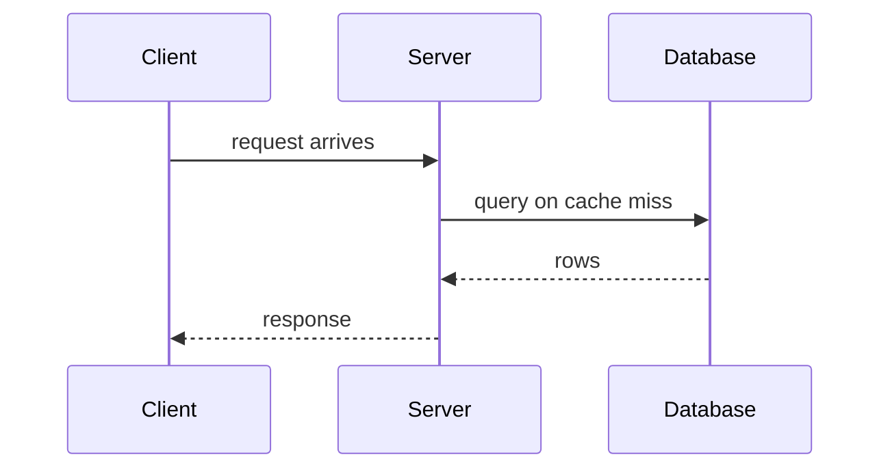
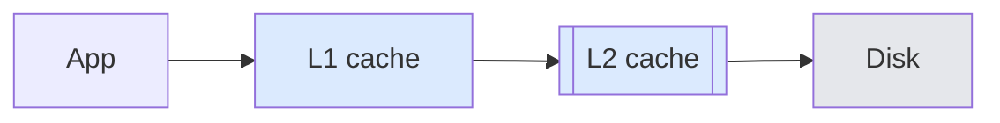
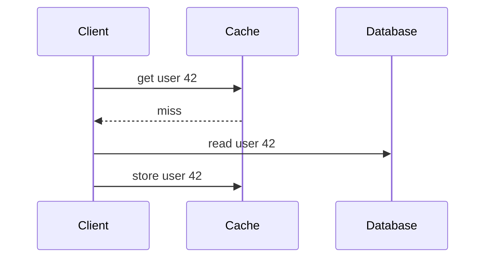

# Explanation examples

Each pair shows a weak explanation, a better one, and what specifically changed.
The "better" versions illustrate the operations. They are not templates: choose
each answer's structure from its own content. The last section shows requests where the right move is to
add nothing.

## Contents

<!-- op:sequencing,mechanism -->
- Software engineering: why a connection pool speeds up a web app
- Computer science: why hash-table lookup is constant time on average
<!-- /op:sequencing,mechanism -->
<!-- op:sequencing -->
- Mathematics: what a derivative is
<!-- /op:sequencing -->
<!-- op:sequencing,examples -->
- Mathematics: why dividing by a fraction means multiplying by its reciprocal
<!-- /op:sequencing,examples -->
<!-- op:mechanism -->
- Everyday: why a pressure cooker cooks faster
- Code: explaining a debounce function
<!-- /op:mechanism -->
- Follow-up confusion: repairing one link
<!-- op:visual -->
- Visual forms: flow, contrast, proportion, change over time, order in time,
  differentiated parts, two states, specimens, scannable tables, a decision table
  with its reasoning underneath, a figure and the text beside it, a checkable
  question
- Restraint: no visual, and no artifact unless asked
- Opt-in: one artifact when the person asks
<!-- /op:visual -->
- Restraint: requests where the skill should add nothing

<!-- op:sequencing,mechanism -->
## Software engineering: connection pools

**User (backend developer):** Why does using a database connection pool make my
web app faster?

**Weak:**
> A connection pool maintains a cache of database connections that can be
> reused, reducing overhead and improving performance and scalability. You can
> configure the minimum and maximum pool size, idle timeouts, and connection
> validation.

**Better:**
> Opening a database connection is expensive compared with running a typical
> query. The client and server set up a network connection (often with TLS),
> authenticate, and the database allocates resources for the new session; in
> PostgreSQL, for example, each connection gets its own server process. If every
> request opens a fresh connection and closes it afterwards, that setup is paid
> on every request, and it can take longer than the query itself.
>
> A pool opens a set of connections once and keeps them open. A request borrows
> one, runs its queries, and hands it back, and the next request reuses it. The
> setup cost is paid once per connection instead of once per request.
>
> The same mechanism sets the main limit: the pool caps how many connections
> exist. When all of them are busy, new requests wait for one to be returned. A
> pool that is too small becomes a queue, and one that is too large can overload
> the database with concurrent sessions.

**What changed:**
- The problem (per-request setup cost) comes before the solution.
- "Reduces overhead" is replaced by the actual chain: borrow, reuse, cost paid
  once per connection.
- The tradeoff follows from the mechanism instead of appearing as a list of
  configuration knobs nobody asked about.
<!-- /op:sequencing,mechanism -->

<!-- op:sequencing,mechanism -->
## Computer science: hash-table lookup

**User (CS student):** Why is hash-table lookup O(1)? Doesn't it still have to
search?

**Weak:**
> Hash tables use a hash function to map keys to array indices, giving O(1)
> average-case lookup. Collisions are handled by chaining or open addressing.
> The worst case is O(n).

**Better:**
> It rests on one property of arrays: if you know an element's index, you can
> read it directly, because the address is computed from the index. Nothing is
> searched.
>
> A hash table turns a key into an index. A hash function does arithmetic on the
> key, say the string "alice", to produce a number, and that number reduced
> modulo the array size picks a slot. To find "alice" later, you repeat the same
> computation, get the same slot, and go straight there. The work is computing
> the hash and checking that slot, which does not grow with the number of
> stored items.
>
> "Average" matters because two keys can land in the same slot, which is called a
> collision. That slot then holds several entries, which must be checked one by
> one. If the table resizes before it gets too full and the hash spreads keys
> evenly, each slot holds very few entries on average, so lookups stay constant
> on average. If many keys collide, through a poor hash or adversarial input,
> lookup degrades toward scanning a list. That is the O(n) worst case.

**What changed:**
- The prerequisite the question hinges on (arrays give direct access by index)
  comes first and answers "doesn't it have to search?".
- Each step from key to slot is stated, so O(1) follows instead of being
  asserted.
- Collisions are introduced where they explain the word "average", not as a
  detached list of strategies.
<!-- /op:sequencing,mechanism -->

<!-- op:sequencing -->
## Mathematics: what a derivative is

**User (adult returning to maths):** What actually is a derivative?

**Weak:**
> The derivative of f at x is defined as the limit as h approaches 0 of
> (f(x + h) − f(x)) / h. It represents the instantaneous rate of change, or the
> slope of the tangent line.

**Better:**
> Start with something familiar: average speed. If a car covers 120 km in
> 2 hours, its average speed is 120 ÷ 2 = 60 km/h, the change in distance divided
> by the change in time.
>
> That average can hide a lot. The car may have sped up and slowed down. To pin
> down how fast it was going at one moment, take the average over a shorter and
> shorter window around that moment: the last minute, the last second, the last
> millisecond. As the window shrinks, these averages settle towards a single
> value. That value is the speed at that instant.
>
> A derivative is exactly this, for any quantity that changes: the value that
> the average rate of change approaches as the interval shrinks towards zero,
> when it does approach a single value. For smooth curves it does.
> The formula, the limit of (f(x + h) − f(x)) / h as h → 0, writes that
> procedure down: f(x + h) − f(x) is the change, h is the window, and "h → 0" is
> the shrinking. On a graph, it is the slope of the curve at that point.

**What changed:**
- The formal definition depends on two ideas, average rate and shrinking the
  interval. Each is now in place before the formula appears.
- The formula is introduced last and each part is mapped to the idea it encodes.
<!-- /op:sequencing -->

<!-- op:sequencing,examples -->
## Mathematics: dividing by a fraction

**User:** Why does dividing by a fraction mean you flip it and multiply?

**Weak:**
> Dividing by a fraction is the same as multiplying by its reciprocal, so
> a ÷ (b/c) = a × (c/b). Remember: keep, change, flip.

**Better:**
> Division asks "how many of these fit into that?". 6 ÷ 2 asks how many 2s fit
> into 6. The same question works for fractions. 3 ÷ ¼ asks how many quarters fit
> into 3. Each whole holds 4 quarters, so 3 wholes hold 3 × 4 = 12. Dividing by ¼
> became multiplying by 4.
>
> Now try 3 ÷ ¾, with pieces three times as big as a quarter. There are still 12
> quarters in 3, but each piece uses 3 of them, so there are 12 ÷ 3 = 4 pieces.
> That is 3 × 4 ÷ 3, which is 3 × 4/3. The "flip" is those two moves combined:
> multiply by the bottom number (count the small pieces), then divide by the top
> number (group them into the bigger pieces).

**What changed:**
- It starts from what division means, which the rule depends on but never
  states.
- A worked case comes before the general rule, and each step of the case is
  mapped to one half of "flip and multiply".
<!-- /op:sequencing,examples -->

<!-- op:mechanism -->
## Everyday: pressure cookers

**User:** Why does a pressure cooker cook food faster?

**Weak:**
> A pressure cooker traps steam, which increases the pressure, which raises the
> boiling point of water, so food cooks faster.

**Better:**
> In an ordinary pot, water can't get much hotter than about 100 °C at sea level.
> Extra heat goes into turning water into steam, which escapes, rather than
> into raising the temperature. How fast food cooks depends mainly on that
> temperature.
>
> A pressure cooker seals the steam in. The trapped steam raises the pressure,
> and at higher pressure water needs more energy before it can boil, so the
> boiling point rises, to roughly 120 °C in a typical cooker. The food now sits
> in water and steam about 20 °C hotter than in an open pot, and the
> temperature-dependent changes that make food tender run considerably faster.
>
> The same mechanism sets its limits. It only speeds up moist cooking, so it
> can't brown food the way a dry pan does, and you can't check the food
> mid-cook without releasing the pressure.

**What changed:**
- The weak version states the chain correctly but skips the two links that make
  it make sense: why an open pot is capped at boiling, and why temperature is
  what matters.
- The limits are derived from the mechanism rather than listed.
<!-- /op:mechanism -->

<!-- op:mechanism -->
## Code: a debounce function

**User:** Explain this and why each part is needed.

```js
function debounce(fn, wait) {
  let timer;
  return function (...args) {
    clearTimeout(timer);
    timer = setTimeout(() => fn.apply(this, args), wait);
  };
}
```

**Weak:** a line-by-line restatement ("declares a variable timer, returns a
function, clears the timeout, sets a timeout…").

**Better (outline of the content):**
- Purpose first: run `fn` only once calls have stopped for `wait` milliseconds,
  for example to search only after the user stops typing.
- `timer` lives outside the returned function, so every call shares it. That
  shared variable is how one call can cancel the call scheduled by the previous
  one. If it were declared inside, each call would get a fresh `timer` and
  nothing would be cancelled.
- `clearTimeout(timer)` cancels the pending run. This is the line that collapses
  a burst of calls into one. Without it, every call would still fire, only later.
- `setTimeout(…, wait)` schedules a fresh run, so the delay restarts on every
  call.
- `fn.apply(this, args)` inside an arrow function forwards the latest arguments
  and the caller's `this`. The arrow function keeps `this` from the returned
  function.

**What changed:** the parts are explained in the order that makes the behaviour
make sense, and each one is paired with what breaks without it.
<!-- /op:mechanism -->

## Follow-up confusion: repairing one link

**Context:** an earlier answer explained that 3 ÷ ¾ = 4 by counting the 12
quarters in 3 and grouping them.

**User:** I get the quarters part, but why do we divide by 3 at the end?

**Weak:** re-explaining the whole method from the definition of division.

**Better:**
> Because each piece we're counting is ¾ in size, and so is made of 3 quarters.
> We found 12 quarters in total; putting them into groups of 3 gives 12 ÷ 3 = 4
> pieces.

**What changed:** it targets only the link the user named and reuses the
picture they already understand.

<!-- op:visual -->
## Visual forms

Each pair is the same point as prose and as the smallest markdown form that
shows it. The figure replaces the sentences; it does not sit on top of them.

### Flow

**Weak:** "The client sends a SYN, the server replies with SYN-ACK, and the
client sends ACK. After that, data can flow."

**Better:** The handshake is three messages, and data waits for the last one.

`client → SYN → server → SYN-ACK → client → ACK → data`

### Contrast

**Weak:** a paragraph describing the broken config, then a paragraph describing
the working one, then a paragraph describing the difference.

**Better:** The only change is the timeout, and the second block is the one that
finishes.

**Broken: times out**

```diff
- timeout = 1
```

**Working: finishes**

```diff
+ timeout = 30
```

### Proportion

**Weak:** "Reads are about 90% of traffic and writes about 10%."

**Better:** Reads dominate the traffic; the bar is the proportion.

```
reads  █████████░  90
writes █░░░░░░░░░  10
```

### Change over time

**Weak:** a paragraph narrating each moment of a retry.

**Better:** Each row is one moment, and the failure is the row where the
attempt is dropped.

| Moment | Attempt | What the reader sees |
|---|---|---|
| t = 0 | send | ✅ request leaves |
| t = 1 | wait | ⚠️ no reply yet |
| t = 2 | drop | ❌ caller gives up |

When stepping through it would genuinely help, the answer can close with one line:
"Want an interactive version you can step through?" — offered when it fits, not
appended by default.

### Order in time

**Weak:** a flowchart of client, server, and database boxes with unlabelled
arrows. It shows what connects, not what happens first or what waits.

**Better:** The caption says the client waits on the server, which waits on the
database, and only the last arrow carries data back.



### A figure whose parts differ

**Weak:** five identical boxes, so the reader reads every label to find the one
that matters.

**Better:** The caption names the code: blue boxes are caches, grey boxes are
storage, and the double-bordered box is the one that fails.



### Two states at one moment

**Weak:** "Before the fix the counter reads 3; after the fix it reads 4, because
the second write is no longer lost."

**Better:** Each row is one element; the only row that differs is the counter.

| Element | Before the fix | After the fix |
|---|---|---|
| Writes sent | 2 | 2 |
| Counter | ❌ 3 | ✅ 4 |

### A specimen lifted out of the prose

**Weak:** "Set it with something like timeout equals thirty in the client
block, then the output shows a 200."

**Better:** The narrative stays in prose; the specimen sits in its own titled
block the reader can skip or copy.

**Example: the client setting that stops the timeout**

```toml
[client]
timeout = 30
```

### A table built for scanning

**Weak:** cells holding whole sentences, six columns, and a header row that
reads like the body.

**Better:** three columns, one short idea per cell, and the header naming each
dimension.

| Cache | Write cost | Risk on crash |
|---|---|---|
| Write-through | slow | none |
| Write-back | fast | lost writes |

### A decision table with its reasoning underneath

**Weak:** a "Why" column whose cells each hold a paragraph: the workload, the
alternative, the operational cost and the exception, all in one cell.

**Better:** each cell holds the verdict and the one reason that decides it
(✅ use, ⚠️ later, ❌ skip). The conditions sit in a list under the table, one
item per row that needs one.

| Option | Use here? | Deciding reason |
|---|---|---|
| In-process cache | ✅ yes | no network hop |
| Redis | ⚠️ later | a second service to run |
| No cache | ❌ no | the slow query repeats |

- **Redis:** worth adding once a second app instance needs a shared cache, or
  entries must survive a restart.
- **No cache:** acceptable if the slow query turns out to be rare; measure it
  before deciding.

### A figure and the text beside it

**Weak:** a sequence diagram of a cache miss, then four numbered steps that
repeat its four arrows.

**Better:** the diagram carries the order, and the sentences after it carry what
the arrows cannot show.



The client fills the entry, not the cache. So two clients that miss at the same
moment both read the database, which is why some caches put a lock around the
fill.

### A question the reader can check

**Weak:** "What do you think would happen if the cache crashed?"

**Better:**

> Which write policy can lose data on a crash?
> A. write-through  B. write-back  C. neither
>
> **Answer:** B, because its writes sit only in the cache until flushed.

## Restraint: markdown, and no artifact unless asked

**No visual.**
User: "In one sentence: why does ice float?"
Answer with the sentence. A diagram of a lattice would cost more than it shows.

**"Explain this visually" is not an artifact request.**
User: "Explain this visually: why a pool is faster."
Answer with the markdown form (an arrow chain or a two-column before/after).
Leave the reply as text.

## Opt-in: one artifact when the person asks

User: "Make an artifact showing TCP's handshake."

Answer in a few markdown sentences that name the three messages, then one
artifact the person can step through: each click advances one message, the
caption says what to notice, and the colours are labelled (for example green
for a message that arrived, red for one that timed out). The next reply returns
to markdown unless the person said to keep using artifacts.
<!-- /op:visual -->

## Restraint: requests where the skill should add nothing

**Direct fact.**
User: "What's the default port for HTTPS?"
Answer: "443." That one word is the whole answer.

**Narrow expert question.**
User: "Why isn't `Rc<T>` `Send` in Rust?"
Answer:
> Its reference count is an ordinary, non-atomic integer. If two threads cloned
> or dropped handles to the same allocation at once, the updates could race and
> corrupt the count, leading to a use-after-free or a leak. `Arc<T>` covers that
> case with atomic count updates, at some cost per clone and drop.

Leave ownership, threads, and traits implicit. The user's wording shows they
know them.

**Requested brevity.**
User: "In one sentence: why does ice float?"
Answer:
> As water freezes, hydrogen bonds lock its molecules into an open crystal
> lattice that takes up more space than the liquid, so ice is less dense than
> water and floats.

**Not a teaching request.**
User: "Make this paragraph sound more formal." or "Translate this into Spanish."
Do the task. No explanation of register or grammar unless asked.

**Doing first, explaining briefly.**
User: "Fix the off-by-one error in this loop."
Fix it and add a short note on what was wrong, at most a sentence or two. That
note is the whole explanation.
