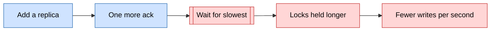
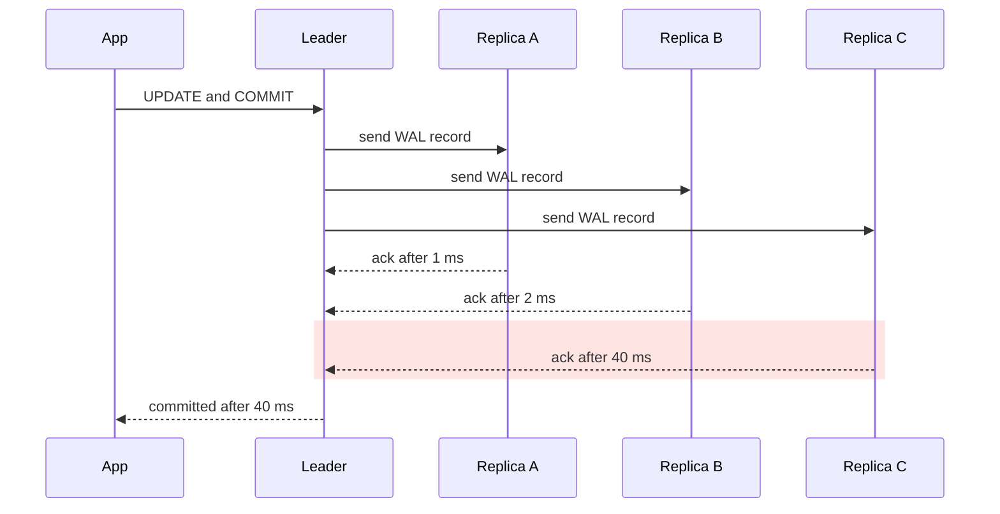
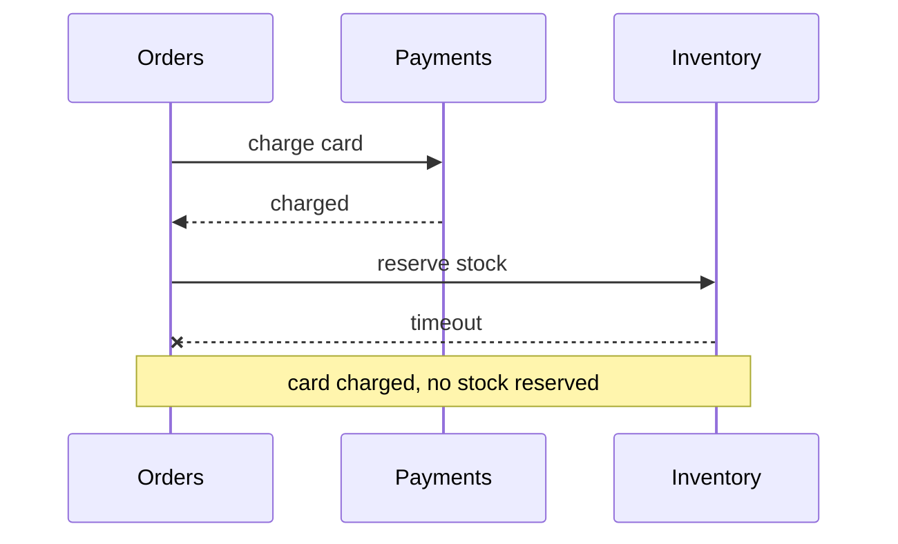
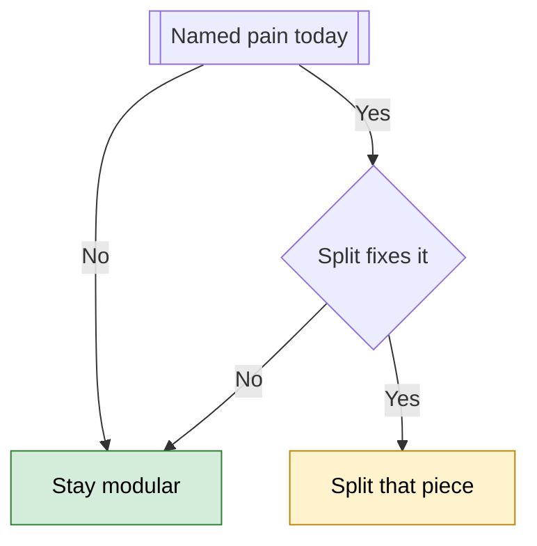
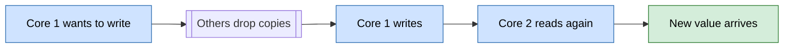

# Layout exemplars

Three complete answers in the page shape from `SKILL.md`. Read one before a long or
teaching answer. Copy the shape and the slot order, never the wording or the topic.
<!-- op:presentation,visual,conversational,examples,terms,close -->

## Contents

1. Replicas: a practitioner's mechanism question
2. Monolith: a practitioner's decision
3. Cache coherence: a beginner's mechanism question

## 1. Replicas: a practitioner's mechanism question

**Prompt:** "Why does adding more replicas to a database sometimes make writes slower
instead of faster? Walk me through the actual chain of cause and effect."

**Reader and intent:** a practitioner asking for a causal chain.

````markdown
# Why more replicas can slow down writes

---

Every replica (a full copy of the database) must apply every write, so adding one never adds write capacity. When the leader (the node that accepts writes) waits for replicas to confirm a commit, each extra replica is one more chance that the wait runs long.

Blue boxes are what you change and red boxes are the harm, with the double-bordered box marking where the time goes.



The answer follows that chain in four steps: 1 · copies don't share writes, 2 · a commit waits for the slowest ack, 3 · locks turn waiting into lost throughput, 4 · how to keep the speed.

---

## 1. 🧩 Copies don't share the writes

Say you run Postgres with one leader and a few replicas, and your shop updates one stock counter 600 times a second. The numbers in this answer are illustrative.

Each replica replays the same stream of changes, so the write work is repeated on every copy instead of divided among them. Replicas add read capacity and a spare to fail over to, but every write still goes through the one leader.

> 🙋 **Then why would more copies make the leader slower?**

Because of what the leader does before it says "committed" to your app. It waits for confirmations, and that wait grows with every replica it has to hear from.

---

## 2. ⏱️ A commit waits for the slowest ack

In synchronous replication (replicas confirm before the leader does), the leader sends each change as a WAL record (an entry in the change log) and holds the commit until replicas acknowledge it. Your app's wait ends at the last ack the leader needs, not at the average one.

One commit with three replicas shows it, and the shaded step is the 40 ms ack the app waits for.



> 🙋 **If most acks take 1 ms, why does one slow replica matter?**

Because the commit takes the slowest ack, not the typical one. Say each replica is slow on 1% of writes, from a disk flush or a network blip; with N replicas, the chance that a write meets at least one slow replica is 1 − 0.99^N.

The table takes slow as 40 ms and fast as 1 ms. Legend: 🟢 mild, 🟡 noticeable, 🔴 severe.

| Replicas | Commits that hit a slow ack | Average commit time |
|---|---|---|
| 1 | 🟢 1% | 1.4 ms |
| 3 | 🟡 3% | 2.2 ms |
| 10 | 🔴 9.6% | 4.7 ms |

This is tail latency (the slowest few percent of requests) leaking into the typical commit. With ten replicas, nearly one commit in ten pays the slow price.

> 🧠 **Think of it like:** a group chat where nobody may leave until everyone has replied "got it". Add people, and it gets likelier that someone is away from their phone. *Where it breaks:* replicas also do real work on every write, which a chat reply does not.

---

## 3. 🔒 Locks turn waiting into lost throughput

While your transaction waits for acks, it still holds its row lock (a claim that blocks other writers). Every other update to that stock counter queues behind it.

So one hot row commits at most about one write per lock-hold time. The bars show that ceiling at each replica count, scaled to the largest.

```
1 replica    ████████████████████  ~720 writes/s
3 replicas   █████████████         ~460 writes/s
10 replicas  ██████                ~210 writes/s
```

**With ten replicas the counter takes about 210 writes a second, and your shop sends 600, so the queue only grows.**

---

## 4. 🛠️ How to keep the replicas and the speed

Each option trades a little safety or effort for commit time.

- ⏱️ **Wait for fewer acks:** use a quorum such as "any 2 of N", so the slowest replicas stop setting commit time.
- ⏭️ **Make most replicas asynchronous:** they still serve reads, but commits stop waiting on them.
- 🔒 **Shorten the hot transaction:** commit the counter update on its own, so each lock is held for less time.
- 📦 **Shard when writes are the limit:** splitting the data across several leaders (sharding) is the only option that adds write capacity.

> 🛑 **Pitfall:** an asynchronous replica can miss the last few writes if the leader fails, so keep at least one synchronous replica for data you cannot lose.

> **For implementers:** in Postgres, `synchronous_standby_names = 'ANY 2 (a, b, c)'` makes a commit wait for any two of three standbys rather than all of them.

---

> 🎯 **Takeaway:** more replicas → wait on the slowest ack → locks held longer → fewer writes per second.

> 🧪 **Check yourself:** Your leader waits for all 5 synchronous replicas, and write latency keeps creeping up. Which change helps most?
> - a) Add a sixth replica
> - b) Require acks from any 2 of the 5
> - c) Move all reads onto the leader
>
> **Answer:** b. It stops the slowest replicas from setting commit time, while a) adds another chance of a slow ack and c) loads the leader without shortening any commit.

Want an interactive version where you move the replica count and watch the ceiling change?
````

**What to notice:**

- **Order:** title and `---`, a two-sentence answer, the overview diagram with its legend, then the map. The scenario opens section 1.
- **Questions:** each 🙋 line stands alone, and the answer follows in body text, never inside the callout.
- **Glosses:** every specialist term gets a parenthesis of six words or fewer on first use.
- **Highlights:** the sequence diagram shades the step to notice with `rect rgb(...)`, and the four options are a labelled list led by icons.
- **Pitfall:** the cost of the async option sits in a 🛑 callout, not inside its bullet.
- **Close:** a four-link 🎯 takeaway, then a 🧪 check with listed options and **Answer:** inside it.

## 2. Monolith: a practitioner's decision

**Prompt:** "We're deciding between keeping our monolith, splitting out two services, or
going full microservices. Team of six, one product, about 40k daily users. What
should we do?"

**Reader and intent:** a practitioner asking for a recommendation.

````markdown
# Keep the monolith, but make it modular

---

Keep the monolith (one app, deployed as one unit), give it clear internal modules, and split out a service only for a pain you can name. For six people and about 40k daily users, full microservices (many small, separately deployed services) would cost far more than they return.

The answer covers four steps: 1 · whether load is the problem, 2 · what a split costs, 3 · when one split is right, 4 · what to do now.

---

## 1. 📊 Your load is not the problem

Say each of your 40,000 daily users makes 50 requests, which is an illustrative guess. That is 2 million requests a day, about 23 a second on average and perhaps 230 at a tenfold peak.

One app with a well-indexed database handles that comfortably. Scale is not what you are solving.

> 🙋 **Then why do companies split into services at all?**

Mostly for people, not load: dozens of engineers stop blocking each other when each team ships its own service. Six people on one product rarely have that problem.

---

## 2. ⚖️ What a split costs

The table scores each option for a team of six. Legend: ✅ fits, ⚠️ fits only with a reason, ❌ costly.

| Option | Deployables | Network failure paths | Ops load |
|---|---|---|---|
| Modular monolith | ✅ One | ✅ None inside | ✅ Low |
| Monolith plus two services | ⚠️ Three | ⚠️ A few | ⚠️ Moderate |
| Full microservices | ❌ One per service | ❌ Many | ❌ High |

The obvious plan is to split by feature so people move faster. It fails here because six people rarely block each other, and you pay for every split anyway.

> 💡 **Key idea:** every split turns a function call into a network call, and a network call can time out, retry, or half-succeed.

Take checkout, which charges the card and then reserves stock. Split into three services, it can fail halfway, as the last arrow shows.



In the monolith, both steps sit in one database transaction (all writes succeed or none do), so this half-done state cannot happen. Across services, you must write an undo step (a compensating action) for each such gap.

> 🧠 **Think of it like:** one kitchen versus a separate kitchen for every dish, with couriers carrying plates between them. A six-person restaurant gains little and spends its day walking. *Where it breaks:* a lost courier is easy to see, while a network call can half-succeed silently.

---

## 3. 🔀 One split is right only for a named pain

A split earns its cost when it removes a concrete problem, such as a CPU-heavy job slowing checkout or a part that must be walled off for security. Many pains need less than a service, though.

The flowchart shows the two checks to pass first. Legend: green is stay put, yellow is split with care.



The second check matters most. A slow report job, for example, is fixed by a background worker from the same codebase, which isolates the load without a new service to deploy and monitor.

---

## 4. 🛠️ What to do now

These steps keep a later split cheap without paying for it today.

1. **Draw module boundaries.** Make orders, payments and inventory modules with small interfaces, and stop each from reading another's tables.
2. **Move slow jobs to a background worker.** Use the same codebase and database, so no network call can fail.
3. **Write down your split triggers.** For example, one part needing ten times the CPU of the rest, so the next debate starts from evidence.
4. **Revisit when a trigger fires.** Leave the question closed until then.

> **For implementers:** enforce the boundaries with a lint rule in CI, and give each module its own schema, even on a shared database server.

---

> 🎯 **Takeaway:** small team and small load → one modular app → split one piece only for a named pain.

> 🧪 **Check yourself:** A nightly report job slows checkout. What is the cheapest first fix?
> - a) Build a reports microservice
> - b) Run the job in a background worker
> - c) Rewrite the report in another language
>
> **Answer:** b. It isolates the load without adding network calls or a new deployment.

If you tell me which part hurts today, I can say whether it is worth splitting.
````

**What to notice:**

- **Decision answers ask too:** one 🙋 question, answered in body text.
- **Status table:** the legend comes before the table, and every marker opens its cell.
- **Running example:** checkout runs through the cost section, with the obvious plan named and refuted first.
- **Key idea:** the one fact the decision turns on sits in a 💡 callout.
- **Takeaway:** a single three-link chain, not two chains joined.

## 3. Cache coherence: a beginner's mechanism question

**Prompt:** "How do CPU cores keep their caches in sync?"

**Reader and intent:** a beginner asking how something works.

````markdown
# How processor cores keep their caches in sync

---

Each core (one worker inside the processor) keeps its own small, fast copy of recently used memory, called a cache. Before a core changes a value, the hardware tells every other core to throw away its copy, so no core keeps reading the old one.

Blue steps are what a core does and green is the moment the copies agree again, with the double-bordered step doing the work.



The answer takes three steps: 1 · why copies go stale, 2 · how the hardware fixes it, 3 · what it costs you.

---

## 1. 🧩 Why copies go stale

Say two cores both read a counter that holds 5, so each now has a copy in its own cache. Core 1 adds one and writes 6 into its copy.

Core 2 still holds 5, a stale copy (one that is out of date). If nothing else happened, it would keep reading 5 from its own cache.

> 🙋 **Why not have every core read straight from main memory?**

Because main memory (the computer's large, slower store) is roughly a hundred times slower than a core's cache. Caches exist so that most reads never make that trip.

---

## 2. 🔄 Invalidate before you write

The fix is a coherence protocol (rules the caches follow together). A common family is called MESI, after the four states a cached copy can be in: Modified, Exclusive, Shared and Invalid.

Each row is one moment in the counter example, and the row to notice is the second, where Core 2's copy is thrown away.

| Moment | Core 1's copy | Core 2's copy |
|---|---|---|
| Both read | Shared, 5 | Shared, 5 |
| Core 1 asks to write | Modified, 6 | Invalid |
| Core 2 reads again | Shared, 6 | Shared, 6 |

An invalid copy cannot be read, so Core 2's next read misses its cache and fetches 6. The hardware does all of this on its own, and your program never sends these messages.

> 🧠 **Think of it like:** a recipe that several cooks copied onto cards. Before one cook changes it, she calls out "bin your cards", and anyone who needs it fetches a fresh copy. *Where it breaks:* the hardware tracks copies in fixed blocks, usually 64 bytes, not whole recipes.

---

## 3. ⚡ What it costs you

Invalidation is not free: each write to shared data sends messages between cores, and the other cores then miss their caches. It hurts most when two cores write different variables that sit in the same cache line (the block a cache tracks), which is called false sharing.

This answer simplifies one thing on purpose. Coherence keeps each single value consistent, but the order in which several writes become visible is a separate topic, called memory ordering.

> **For implementers:** give per-thread counters their own cache lines, for example with `alignas(64)` in C++.

---

> 🎯 **Takeaway:** a core wants to write → other copies are invalidated → the next read fetches the new value.

> 🧪 **Check yourself:** Core 1 and Core 2 both hold a copy of a value, and Core 1 writes to it. What happens to Core 2's copy?
> - a) It is updated in place to the new value
> - b) It is marked invalid, so the next read fetches the new value
> - c) Nothing, so Core 2 keeps reading the old value
>
> **Answer:** b. MESI-style protocols invalidate the other copies before a write, which is why Core 2's next read fetches the fresh value.
````

**What to notice:**

- **Beginner register:** every term is taught where it first appears, and code tokens sit in the **For implementers:** block.
- **State, action, result:** the counter example traces 5, then a write, then 6, and the table shows each moment.
- **Accuracy:** the answer says what it simplifies and names the topic it leaves out.
<!-- /op:presentation,visual,conversational,examples,terms,close -->
